# PART 2 — Module & Page Mapping

## Executive Table of Contents

- [1.1 Dashboard (`/dashboard`)](#11-dashboard-dashboard)
- [1.2 POS (`/pos`)](#12-pos-pos)
- [1.3 Sales (`/sales`)](#13-sales-sales)
- [1.4 Products (`/products`)](#14-products-products)
- [1.5 Inventory (`/inventory`)](#15-inventory-inventory)
- [1.6 Purchasing (`/purchasing`)](#16-purchasing-purchasing)
- [1.7 Customers (`/customers`)](#17-customers-customers)
- [1.8 Finance (`/finance`)](#18-finance-finance)
- [1.9 Shifts (`/shifts`)](#19-shifts-shifts)
- [1.10 Reports & Analytics (`/reports`)](#110-reports--analytics-reports)
- [1.11 Settings & Business Administration (`/settings/*`)](#111-settings--business-administration-settings)
- [1.12 Employees & Access Control (`/access`)](#112-employees--access-control-access)
- [1.13 Branch Stock Transfers (`/inventory/transfers`)](#113-branch-stock-transfers-inventorytransfers)
- [1.14 Authentication, Onboarding & User Lifecycle](#114-authentication-onboarding--user-lifecycle)
- [1.15 SaaS Platform Administration (`/platform`)](#115-saas-platform-administration-platform)

---

## 1. Main Application Navigation

### 1.1 Dashboard (`/dashboard`)

The Dashboard is the operational mission control for store managers, cashiers, and business owners. It provides real-time situational awareness across sales velocity, order volumes, revenue, expenses, profitability, inventory health, and recent store transactions.

---

### Key Sections & Component Architecture

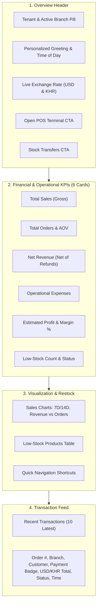

---

### Detailed Feature Breakdown

#### 1. Overview
- **Tenant & Branch Status**: Dynamic badges displaying the active workspace company name and selected branch location (or "All Branches" aggregated view).
- **Dual Currency & Exchange Rate Bar**: Shows current base currency rate (e.g., `1 USD = 4,100 KHR`).
- **Personalized Header**: Dynamic greeting (`Good morning`, `Good afternoon`, `Good evening`) with logged-in user name and role.
- **Quick Action Bar**:
  - `Open POS Terminal` button (instant routing to touchscreen cashier interface)
  - `Branch Transfers` shortcut
  - `Refresh` button with live spin state

#### 2. Total Sales (Gross)
- Displays aggregated gross sales across completed orders before refunds or discount deductions.
- Dual-currency presentation: primary currency (USD/KHR) accompanied by automatic counterpart conversion (`≈ ៛XXX,XXX` or `≈ $XX.XX`).
- Subtext: *"Gross sales before returns"*.

#### 3. Total Orders
- Count of completed, active sales orders.
- Average Order Value (AOV) calculated dynamically: $\text{AOV} = \frac{\text{Net Revenue}}{\text{Total Orders}}$.
- Subtext: *"Avg. basket size"*.

#### 4. Revenue (Net)
- Net sales revenue deducting returns and refunds: $\text{Revenue} = \text{Gross Sales} - \text{Total Refunds}$.
- Identifies cash retained after customer returns.

#### 5. Expenses
- Total operational expenses logged within the selected scope (supplies, utilities, rent, logistics, salaries).
- Dual-currency display in primary and secondary currencies.

#### 6. Estimated Profit
- Net estimated operating profit:
  $$\text{Estimated Profit} = \text{Gross Profit} + \text{Additional Income} - \text{Total Expenses}$$
- Dynamic profit margin percentage badge:
  $$\text{Profit Margin} = \left(\frac{\text{Estimated Profit}}{\text{Net Revenue}}\right) \times 100\%$$
- Visual state: Emerald styling for positive profit margin, rose styling for negative margin.

#### 7. Low-Stock Products
- Summarizes items at or below configured `lowStockAlert` threshold.
- Interactive list displaying Product Name, SKU, Branch Name, On-Hand Quantity, and Alert Threshold.
- Severity tag: `Critical (0 left)` vs `Low (< threshold)`.
- One-click navigation to `/inventory` for manual adjustment or `/purchasing` for restock purchase orders.

#### 8. Recent Transactions
- Real-time tabular stream of the 10 most recent orders:
  - **Order Number**: Monospace copyable identifier (e.g. `ORD-2026-0001`).
  - **Branch**: Originating store branch.
  - **Customer**: Customer profile name or *"Walk-in"*.
  - **Payment Badge**: Displays payment method (`CASH`, `ABA KHQR`, `ACLEDA`, `SPLIT`).
  - **Total Amount**: Highlighted amount formatted in transaction currency.
  - **Status Badge**: `COMPLETED` (green), `PENDING` (amber), `CANCELLED` (red).
  - **Timestamp**: Formatted time (e.g., `10:45 AM`).
  - Link to `/sales` to view all orders.

#### 9. Sales Charts
- Interactive dual-mode chart:
  - **Metric Switcher**: Toggle between **Revenue ($)** and **Order Volume**.
  - **Timeframe Selector**: Toggle between **Last 7 Days (7D)** and **Last 14 Days (14D)**.
  - **Visual Bars**: CSS height percentage with gradients (emerald for revenue, blue for orders).
  - **Hover Tooltips**: Shows exact calendar date, revenue in USD, and order count.
  - **Summary Metrics Strip**: Displays Period Total Revenue, Total Orders, and Daily Average Sales.

---

### Backend API Reference

- **Route**: `GET /api/v1/reports/dashboard`
- **RBAC Guard**: `requirePermission('reports.view')`
- **Query Parameters**:
  - `branchId` *(optional, UUID)*: Filters metrics to a specific branch. Omit for tenant-wide aggregated view.
- **Response Shape**:
```json
{
  "success": true,
  "data": {
    "currencyCode": "USD",
    "exchangeRate": "4100",
    "totalSales": "1250.00",
    "revenue": "1210.00",
    "grossSales": "1250.00",
    "netRevenue": "1210.00",
    "totalOrders": 48,
    "averageOrderValue": "25.21",
    "totalExpenses": "210.00",
    "additionalIncome": "50.00",
    "estimatedProfit": "480.00",
    "profitMargin": "39.7",
    "lowStockCount": 3,
    "lowStockItems": [
      {
        "productId": "7b0e451b-4f9e-4c7b-8321-0a6311895a91",
        "name": "Angkor Beer Can",
        "sku": "BEER-01",
        "branchName": "HQ Store",
        "quantity": "4",
        "lowStockAlert": "10",
        "isCritical": false
      }
    ],
    "recentTransactions": [
      {
        "id": "14f2e964-b5de-472e-8367-93e5066db7aa",
        "orderNumber": "ORD-2026-0048",
        "branchName": "HQ Store",
        "customerName": "Sokha Chan",
        "customerPhone": "+85512345678",
        "totalAmount": "25.00",
        "currencyCode": "USD",
        "status": "COMPLETED",
        "createdAt": "2026-11-13T04:45:00.000Z",
        "paymentMethod": "CASH",
        "paymentMethods": ["CASH"]
      }
    ],
    "salesChart": [
      { "date": "2026-10-31", "amount": "85.00", "orders": 4 },
      { "date": "2026-11-01", "amount": "120.00", "orders": 6 }
    ]
  }
}
```

---

### 1.2 Point of Sale (POS) (`/pos`)

The POS interface is the primary operational touchscreen terminal for retail store cashiers, optimized for high-volume scanning, dual-currency pricing (USD & KHR), split payments, and instant receipt generation.

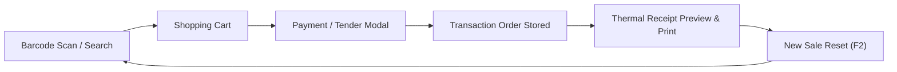

---

### Feature Breakdown

#### 1. New Sale
- **Instant State Reset**: Dedicated "New Sale" button (`RotateCcw` icon) with keyboard shortcut (`F2`) resets the cart, customer selection, order discounts, taxes, and tender lines.
- **Cart Protection**: Prompts for confirmation before discarding active items in the cart.
- **Auto-Focus**: Immediately shifts focus back to the barcode / search input for rapid consecutive customer processing.
- **Direct Receipt Transition**: "Start New Sale" button on the receipt modal immediately clears the finished order and readies the register for the next customer in line.

#### 2. Product Search
- **Instant Filtering**: Real-time filtering across product **Name**, **SKU**, and **Barcode** simultaneously.
- **Category Filter Pills**: Fast category buttons (`All`, `Beverages`, `Snacks`, etc.) displaying active item counts.
- **Dual Currency Product Badges**: Displays pricing in primary currency alongside real-time counterpart conversion (`$1.50 ≈ ៛6,150`).
- **Inventory Badges**: Visual stock indicators showing available stock quantity or `∞` for non-inventory products, with soft red alerts for items with `0` stock.

#### 3. Barcode Scanning
- **Hardware Scanner Integration**: Compatible with USB and Bluetooth handheld barcode scanners emitting keystrokes followed by an `Enter` terminator.
- **Instant Cart Insertion**: Matches exact barcode or SKU on `Enter`, adding the item or incrementing its quantity immediately without mouse interaction.
- **Web Audio Chime**: Synthesized audio frequency chime (1400Hz sine beep via Web Audio API) providing instant acoustic feedback upon each valid scan.
- **Visual Toast Feedback**: Displays animated confirmation toast (`Scanned: Angkor Beer Can (BEER-01)`).
- **Auto-Clear Scanner Buffer**: Clears the input buffer immediately after processing a scan so subsequent scans are never concatenated.

#### 4. Shopping Cart
- **Item Controls**:
  - Quantity counter with `-`, direct number edit, and `+` buttons.
  - Line-level discount input (`Item Discount`).
  - Unit price in primary and secondary currency.
  - Line total calculation with discount deduction.
  - Line item deletion (`Trash2`).
- **Stock Guard Warnings**: Highlights line items in amber if the requested quantity exceeds on-hand stock.
- **Customer Association**: Selector for Walk-in Customer or registered customer profile.
- **Order-Level Financials**:
  - Order-level discount input (validated against subtotal).
  - Tax (VAT) computation (auto-calculated from tenant settings `taxRatePercent` or manual override).
  - Dual currency Grand Total (`$25.00 ≈ ៛102,500`).
  - Shortcut `F4` to trigger Checkout.

#### 5. Payment
- **Multi-Method Tender Modes**:
  - `CASH`: Fast cash checkout with Quick Tender buttons.
  - `ABA / KHQR`: Real-time dynamic Bakong KHQR payload generation and deep link (`bakong://pay?qr=...`) for instant customer scanning.
  - `ACLEDA`: Bank transfer with reference/approval number.
  - `SPLIT PAYMENT`: Multi-line tender splitting across different payment methods and currencies (e.g. paying \$10 USD Cash + ៛20,500 KHR ABA).
- **Quick Cash Tender Buttons**: 1-click cash amount shortcuts (USD: `Exact`, `$5`, `$10`, `$20`, `$50`, `$100`; KHR: `Exact`, `៛10,000`, `៛20,000`, `៛50,000`, `៛100,000`).
- **Real-Time Change Due**: Automatic calculation of change due in both primary currency and secondary counterpart currency.
- **Offline Resiliency**: Automatically queues orders to IndexedDB if network is offline and continues cashier workflow without interruption.

#### 6. Receipt
- **Thermal Printer Formats**: Optimized for standard **80mm** and compact **58mm** thermal receipt printers.
- **Branding & Header**: Business Name, Store Logo, Branch Name & Phone, VATTIN / Tax ID.
- **Audit Details**: Receipt / Order Number (e.g. `ORD-2026-0001`), Date & Time, Cashier Name, Customer Name.
- **Itemized Ledger**: Line items with snapshot names, quantities, unit prices, and line totals.
- **Financial Summary**: Subtotal, Discounts, Tax (VAT), Total Amount, Paid Amount, Change Due, and Payment Method breakdown.
- **Custom Footer Notice**: Configurable receipt footer notice (e.g. return policy, WiFi password).
- **One-Click Actions**:
  - `Download Receipt` (HTML format).
  - `Print Receipt` (`window.print()` trigger).
  - `Start New Sale` (`RotateCcw` trigger).

---

### 1.3 Sales (`/sales`)

The Sales module is the post-transaction hub for order records, payment settlement audit logs, customer refunds, and return reconciliation.

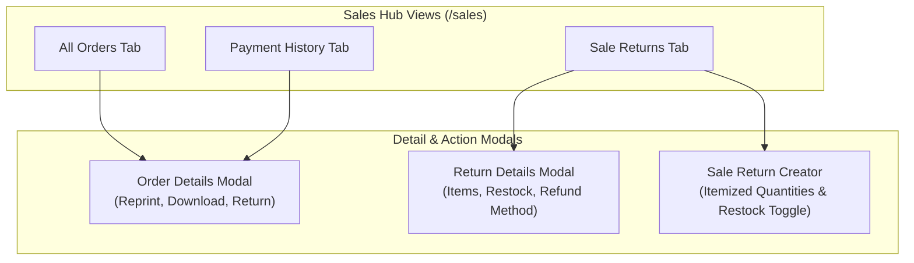

---

### Feature Breakdown

#### 1. All Orders
- **Multi-Branch Filtering**: Filter transactions by originating branch location or view aggregated multi-store orders.
- **Status Lifecycle Filters**:
  - `ALL`: Complete transaction history.
  - `COMPLETED`: Settled and fulfilled orders.
  - `PENDING`: Unpaid or layaway orders awaiting settlement.
  - `PARTIALLY_RETURNED`: Orders with some items refunded.
  - `RETURNED`: Orders fully refunded.
  - `CANCELLED` / `VOIDED`: Aborted orders.
- **Quick Search**: Real-time searching by Order Number (e.g. `ORD-2026-0001`) or Customer Name.
- **Order Columns**: Order #, Branch, Customer, Total Amount, Paid Amount, Balance Due / Status, Cashier Name, and Timestamp.
- **One-Click Drilldown**: Click any order row or "View Details" to open the Order Details modal.

#### 2. Order Details
- **Header & Audit Info**: Full order number, status badge, branch name, address, telephone, cashier employee name, and customer contact.
- **Itemized Breakdown**:
  - Product Name and SKU snapshot (retains historical names even if products are renamed).
  - Unit price in transaction currency.
  - Quantity sold.
  - Line-level discount amount applied.
  - Line total.
- **Financial Summary**: Subtotal, Order-level Discount, Tax (VAT), Grand Total, Paid Amount, and Change Due.
- **Payment Tenders**: List of each payment method used (`CASH`, `ABA`, `ACLEDA`), tender amount, currency, and transaction reference numbers.
- **Return Ledger on Order**: Directly displays any previous returns and refunds associated with this order.
- **Actions**:
  - `Print Receipt`: Re-triggers thermal receipt print format.
  - `Download Receipt`: Exports receipt as HTML file.
  - `Process Return`: Launches itemized return workflow for eligible items.

#### 3. Payment History
- **Audit Ledger**: Comprehensive audit trail of all financial inflows and customer payment tenders across all orders.
- **Payment Method Filters**: Filter by `CASH`, `ABA`, `ACLEDA`, `OTHER`, or view all tenders.
- **Payment Currency Filters**: Filter transactions by `USD` or `KHR`.
- **Search**: Search by Order Number or Bank Transaction Reference # (e.g. ABA approval code).
- **Columns**: Order # (hyperlinked to order detail), Branch, Payment Method badge, Amount in tender currency, Converted equivalent in order currency, Reference #, Status (`SUCCESS`), and Payment Timestamp.

#### 4. Sale Returns
- **Return Registry**: Log of all merchandise returned by customers and refund payouts.
- **Method & Branch Filters**: Filter by branch and refund tender method.
- **Search**: Search by Return Number (e.g. `SR-2026-0001`) or original Order Number.
- **Restock Indicator**: Displays whether returned inventory was returned to branch stock (`RESTOCKED`, `NOT_RESTOCKED`, `PARTIALLY_RESTOCKED`).
- **Initiate New Return**:
  - Select original order via interactive Sale Picker.
  - Item-by-item selection of return quantities (validated against remaining refundable quantity).
  - Restock decision per item (damaged goods vs shelf-restockable).
  - Proportional refund calculation factoring original order-level discounts.
  - Refund payment method selection (`CASH`, `ABA`, etc.) and audit reason input.

#### 5. Return Details
- **Dedicated Modal View**: Launched by clicking the Return # or "View" action button.
- **Audit Identification**: Return Number, Timestamp, Originating Branch, and Processing Cashier Name.
- **Original Order Linkage**: Direct hyperlinked reference to original Order #, customer name, and order date.
- **Return Reason & Restock Decision**: Displays customer reason and inventory restock status.
- **Returned Items Table**:
  - Product Name and SKU.
  - Quantity Returned.
  - Restocked Quantity to Branch Inventory.
  - Original Unit Price.
  - Line Item Refund Amount.
- **Refund Payment Summary**: Total refund payout amount and tender method used.
- **Print Note**: Formatted print preview for customer credit notes.

---

### 1.4 Products (`/products`)

The Products Catalog is the master repository for store inventory definitions, product metadata, category hierarchies, units of measurement, and wholesale suppliers. It enforces tenant isolation, dual-currency pricing (USD & KHR conversion), SKU/barcode uniqueness, and real-time inventory tracking thresholds.

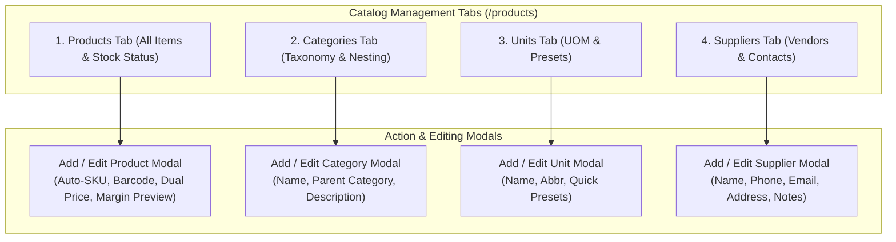

---

### Feature Breakdown

#### 1. All Products
- **Summary Metric Counters**:
  - **Total Products**: Global tally of registered products across all catalog categories.
  - **Active Catalog**: Number of active items live for POS ringing.
  - **Low Stock Alerts**: Interactive card highlighting items where $0 < \text{Stock} \le \text{Alert Threshold}$; clicking immediately applies the low stock filter.
  - **Out of Stock**: Interactive card showing items depleted to 0 or below; clicking immediately filters for replenishment candidates.
- **Filters & Search**:
  - **Real-Time Search**: Instant search by Product Name, SKU, Barcode, or Category Name.
  - **Category Filter**: Dropdown to isolate specific department/category items.
  - **Stock Filter**: Toggle between `All Stock Levels`, `Low Stock`, `Out of Stock`, and `In Stock`.
  - **Status Filter**: Toggle between `ALL`, `ACTIVE`, and `ARCHIVED`.
- **Table Data Columns**:
  - **Product**: Name and Unit badge (e.g. `Angkor Beer (can)`).
  - **SKU / Barcode**: Monospace copyable identifiers with Barcode icon.
  - **Category**: Visual badge pill.
  - **Cost Price**: Displayed in primary currency alongside automatic counterpart conversion (`≈ ៛XXX` or `≈ $XX`).
  - **Selling Price**: Primary selling price with converted secondary currency equivalent.
  - **Gross Profit Margin**: Dynamically computed margin percentage:
    $$\text{Margin \%} = \left(\frac{\text{Selling Price} - \text{Cost Price}}{\text{Selling Price}}\right) \times 100\%$$
  - **Stock Health**:
    - `∞ Unlimited` for non-tracked inventory.
    - `0 (Out of stock)` in rose badge when depleted.
    - `⚠️ X (Low Stock)` in amber badge when below threshold.
    - Standard emerald count for healthy inventory.
  - **Status**: `ACTIVE` or `ARCHIVED` pill.
  - **Actions**:
    - `Edit`: Opens product modification modal.
    - `Archive`: Soft-deletes product from active POS ringing (`products.archive` permission).
    - `Activate`: Restores archived products back to the active catalog.

#### 2. Add Product / Edit Product
- **Core Information**:
  - **Product Name**: Unicode-compliant bilingual names (Khmer and English).
  - **SKU Generator**: One-click `Auto` generator synthesizing structured alphanumeric SKUs (e.g. `ANG-7K9A`).
  - **Barcode Generator**: One-click `Auto` generator synthesizing standard retail barcodes (e.g. `885123456789`).
  - **Category & Unit Selection**: Mandatory relational link to existing categories and units.
- **Pricing & Dual Currency**:
  - **Cost Price Input**: Live counterpart currency conversion using tenant's configured exchange rate.
  - **Selling Price Input**: Real-time secondary currency preview.
  - **Gross Profit Margin Bar**: Real-time calculated gross profit dollar amount and percentage margin.
  - **Wholesale Price**: Optional bulk tier pricing for B2B/wholesale transactions.
- **Inventory Settings**:
  - **Track Inventory Toggle**: Checkbox controlling whether stock movements and deductions apply.
  - **Low Stock Alert**: Configurable warning threshold (defaults to 5).
  - **Opening Stock**: On product creation, allows immediate stock initialization assigned to the active or main branch.

#### 3. Categories
- **Catalog Structure**: Hierarchical classification supporting top-level categories and optional nested parent categories.
- **Data Columns**:
  - Category Name.
  - Parent Category reference (for subcategories).
  - Description / shelf location.
  - Products Count badge (`_count.products`).
  - Status (`ACTIVE` / `INACTIVE`).
  - Actions (`Edit`).
- **Modal Controls**: Name, Parent Category dropdown, Description, and Status toggle.

#### 4. Units of Measurement
- **Unit Registry**: Standardizes measurement units across inventory, purchasing, and POS carts (e.g. Piece, Can, Box, Bottle, Pack, Kilogram, Set).
- **Quick Preset Chips**: Interactive 1-click preset chips in the modal (`Piece (pcs)`, `Can (can)`, `Box (box)`, `Bottle (btl)`, `Pack (pack)`, `Kilogram (kg)`, `Set (set)`) to eliminate manual typing.
- **Data Columns**: Unit Name, Abbreviation badge, Linked Products count, Status, and Edit action.

#### 5. Suppliers
- **Vendor Directory**: Contact repository for replenishment purchase orders.
- **Data Columns**:
  - Supplier Name.
  - Contact Person.
  - Phone Number.
  - Email Address.
  - Physical Address.
  - Linked Purchases Count badge (`_count.purchases`).
  - Status (`ACTIVE` / `INACTIVE`).
  - Actions (`Edit`).
- **Modal Controls**: Full contact information, internal vendor notes (delivery terms, credit line), and active status toggle.

---

### 1.5 Inventory (`/inventory`)

The Inventory module is the central warehouse control and audit system for branch-level stock balances, immutable transaction movements, cycle count adjustments, low-stock threshold alerting, and per-product historical audit ledgers.

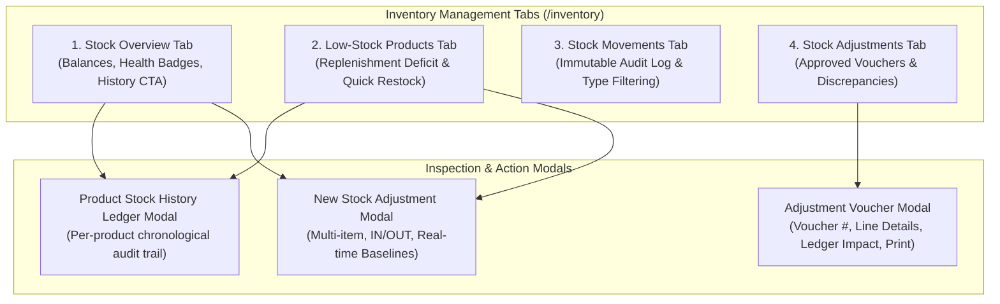

---

### Feature Breakdown

#### 1. Stock Overview
- **Warehouse Summary KPI Metrics**:
  - **Tracked Products**: Total registered items with active stock tracking enabled.
  - **Total On-Hand**: Aggregated physical stock units across all inventory items.
  - **Low Stock Alerts**: Count of items where on-hand quantity is at or below the alert threshold ($0 < \text{Stock} \le \text{Threshold}$); clicking instantly navigates to the Low-Stock tab.
  - **Out of Stock**: Count of depleted items ($\text{Stock} \le 0$); clicking navigates to the Low-Stock tab.
- **Data Columns**:
  - **Product**: Product Name and Unit of Measure (`pcs`, `can`, `box`, `btl`, `kg`).
  - **SKU / Barcode**: Monospace copyable identifiers.
  - **Branch**: Store branch location where inventory resides.
  - **On Hand**: Bold on-hand quantity color-coded by stock level (rose for 0, amber for low stock, slate for healthy).
  - **Alert Threshold**: Minimum safe stock level.
  - **Health Status**: Visual badge pills:
    - `HEALTHY` (emerald): Sufficient stock on hand.
    - `LOW STOCK` (amber): At or below alert threshold.
    - `OUT OF STOCK` (rose): Completely depleted.
  - **Actions**:
    - `Stock History` (clock icon): Opens the per-product Stock History Ledger modal.
    - `Adjust` (sliders icon): Launches the stock adjustment modal with the product pre-selected.

#### 2. Stock Movements
- **Immutable Audit Trail**: Append-only ledger recording every stock fluctuation with before-and-after balances:
  - `opening_stock`: Initial balance allocated on product creation.
  - `purchase_in`: Stock received from supplier purchase receipts.
  - `sale_out`: Stock decrements fulfilled at POS checkout.
  - `sale_return_in`: Stock returned and restocked from customer refunds.
  - `adjustment_in`: Upward physical count corrections.
  - `adjustment_out`: Downward write-offs for damaged, expired, or missing stock.
  - `transfer_in` / `transfer_out`: Inter-branch inventory transfers.
- **Movement Type Filter**: Dropdown to isolate specific movement categories.
- **Search**: Filter by Product Name, SKU, branch, or line notes.
- **Data Columns**: Product & SKU, Branch, Movement Type badge with directional arrows, In (`+X` green), Out (`-X` red), Balance After (bold), Logged By (Employee name), Notes/Reference, and Timestamp.

#### 3. Stock Adjustments & Vouchers
- **Stock Adjustment Lifecycle**:
  - Document numbering sequence using tenant-configurable prefix (`ADJ-2026-0001`).
  - Strict RBAC protection requiring `inventory.adjust` permission (read-only users can view but cannot adjust).
  - Pre-validation against untracked items, archived items, or negative stock drops exceeding on-hand quantities.
  - Auto-approved status tracking with creator and approver employee records.
- **Data Columns**: Adjustment Number, Date, Branch, Reason, Adjusted By, Approver, Status, and Action (`View Voucher`).
- **Adjustment Voucher Modal (`GET /api/v1/inventory/adjustments/:id`)**:
  - Official warehouse voucher header with Document #, Branch, Processing Date, Adjuster, Approver, and Reason.
  - Itemized table of affected products: Product Name, SKU, Direction (`+ INCREASE` / `- DECREASE`), Quantity, Resulting Balance, and Line-level Notes.
  - 1-click `Print Voucher` button triggering formatted window print layout.
- **New Stock Adjustment Creator Modal**:
  - Supports single or multi-item batch adjustments in a single transaction.
  - Interactive product selector, direction toggle, quantity input, and line note.
  - Pre-fills suggested reason and replenishment quantities when launched from low-stock alerts.

#### 4. Low-Stock Products
- **Dedicated View**: Direct tab designed for store replenishers and inventory auditors to quickly identify shortage items.
- **Deficit Calculation**:
  $$\text{Deficit} = \max(0, \text{Low Stock Alert Threshold} - \text{On-Hand Stock})$$
- **Replenishment Guidance**: Displays exact unit shortfall (e.g. `+12 units needed`) required to restore safe stock buffer.
- **Urgency Classification**:
  - `CRITICAL (0 left)`: Stock completely exhausted; high risk of lost retail sales.
  - `LOW STOCK`: Buffer depleted below configured safety threshold.
- **1-Click Restock Shortcut**: Launches adjustment workflow pre-populated with the affected product, direction `IN`, and suggested replenishment quantity.

#### 5. Stock History (Per-Product Ledger)
- **Product-Scoped Ledger**: Launched from any product row across Stock Overview or Low-Stock lists.
- **Audit Identification**: Displays Product Name, SKU, Barcode, Unit, Branch, and live On-Hand Balance.
- **Complete Chronological History (`GET /api/v1/inventory/movements?productId=...`)**:
  - Every historical movement for that item rendered from opening stock to the latest checkout or adjustment.
  - Date & Time, Movement Type badge, Signed Quantity change (`+X` / `-X`), Balance After, Operator Employee, and Reference / Notes.

---

### 1.6 Purchasing (`/purchasing`)

The Purchasing module is the procurement and accounts payable management engine for retail operations. It controls supplier purchase orders, product cost tracking, automated inventory receiving (goods intake), supplier debt settlement, and printable procurement vouchers.

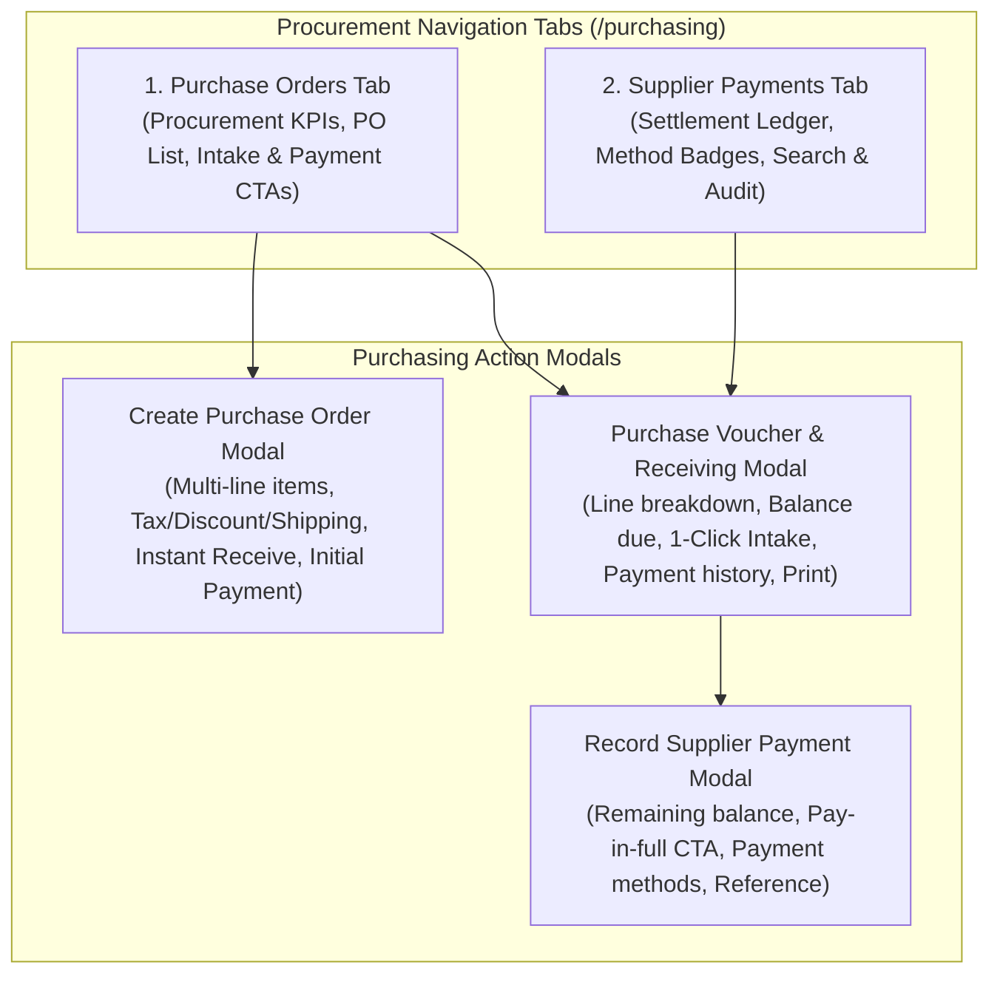

---

### Feature Breakdown

#### 1. Purchase List
- **Procurement KPI Cards**:
  - **Total Purchase Orders**: Aggregated count of created purchase orders.
  - **Total Procurement**: Cumulative procurement value in USD and counterpart KHR (`≈ ៛XXX,XXX`).
  - **Accounts Payable (Due)**: Outstanding balance owed to suppliers for unpaid or partially paid purchase orders; highlighted in rose to flag credit liabilities.
  - **Awaiting Delivery**: Count of orders in `ORDERED` status awaiting physical warehouse receiving.
- **Search & Filtering**:
  - Filter by Order Status (`All`, `ORDERED`, `RECEIVED`, `CANCELLED`).
  - Filter by Supplier dropdown.
  - Text search by PO Number, Supplier name, or reference invoice number.
- **Data Table Columns**:
  - **PO Number**: Monospace identifier (`PO-2026-0001`) with direct click to open PO voucher.
  - **Date**: Formatted issue date and time.
  - **Supplier**: Company name, contact phone, and address.
  - **Branch**: Destination store branch.
  - **Total Amount**: Highlighted procurement cost formatted in dual currencies.
  - **Order Status Badge**:
    - `ORDERED` (blue): Purchase confirmed with supplier; awaiting physical receipt.
    - `RECEIVED` (emerald): Goods inspected and accepted into warehouse stock.
    - `CANCELLED` (rose): Order voided.
  - **Payment Status Badge**:
    - `PAID` (emerald): Fully settled.
    - `PARTIAL` (amber): Partially settled with remaining accounts payable balance.
    - `UNPAID` (rose): No payments recorded yet.
  - **Balance Due**: Bold remaining liability (`$0.00` if settled).
  - **Actions**:
    - `View Details` (eye icon): Opens itemized PO voucher modal.
    - `Receive Goods` (truck/package icon): Instant stock intake shortcut if order status is `ORDERED`.
    - `Record Payment` (cash/card icon): Quick disbursement modal if balance remains.

#### 2. Create Purchase
- **PO Header Details**:
  - Branch selection (defaults to active store branch).
  - Supplier selection with contact phone autofill.
  - Supplier Reference / Invoice Number (optional vendor billing code).
  - Expected Delivery Date picker.
  - Procurement notes and instructions.
- **Dynamic Line-Item Entry**:
  - Multi-item line builder: Product dropdown, Quantity, Unit Cost ($), and computed line subtotal.
  - Interactive row add and delete actions.
  - Auto-fills supplier's default cost price when available.
- **Financial Cost Adjustments**:
  - Subtotal automatically calculated across all active lines.
  - Discount % or fixed discount value input.
  - Tax % input (e.g. 10% VAT).
  - Shipping & Freight Cost input.
  - Grand Total dynamically updated in real-time with dual-currency conversion (USD & KHR).
- **Execution Controls**:
  - **Immediate Stock Intake**: Optional *"Receive into stock immediately"* checkbox (auto-creates `stockMovement` entries with type `purchase_in` and marks status `RECEIVED` upon creation).
  - **Initial Payment Disbursement**: Optional *"Record initial payment now"* toggle:
    - Payment Method selection (`CASH`, `ABA KHQR`, `ACLEDA`, `BANK_TRANSFER`, `CHEQUE`).
    - Paid Amount input (defaults to Grand Total with 1-click settlement).
    - Payment reference note.

#### 3. Purchase Details & PO Voucher
- **Formal Voucher View (`GET /api/v1/purchases/:purchaseId`)**:
  - Header: PO Number, Purchase Date, Branch, and Supplier Contact Card (Name, Phone, Address, Tax ID).
  - Status Indicators: Order Status badge and Payment Status badge.
  - **Itemized Procurement Table**:
    - Product Name, SKU, Unit of Measure.
    - Unit Cost ($), Ordered Quantity, Received Quantity, and Line Total.
  - **Financial Summary Breakdown**:
    - Lines Subtotal.
    - Applied Discount, Tax, and Shipping fees.
    - Net Grand Total.
    - Cumulative Amount Paid to date.
    - Remaining Outstanding Balance (highlighted in red if unpaid).
- **Supplier Payment History Ledger**:
  - Nested audit list of all payments recorded against this PO:
  - Date & Time, Payment Method badge, Reference code, and Amount Paid.
- **Operational Actions**:
  - `Receive Goods`: Triggers backend `POST /api/v1/purchases/:id/receive` to intake inventory, update on-hand branch balances, and write immutable `purchase_in` stock movements.
  - `Record Payment`: Opens payment disbursement modal to reduce accounts payable.
  - `Print PO Voucher`: Triggers browser print preview with a clean corporate purchase order layout.

#### 4. Supplier Payments
- **Dedicated Payment Settlement Ledger (`GET /api/v1/purchases/payments`)**:
  - Filterable by Supplier, Payment Method, and search keyword.
  - Columns: Payment Date, PO Number (clickable link), Supplier Name, Branch, Payment Method (`CASH`, `ABA KHQR`, `ACLEDA`, `BANK_TRANSFER`, `CHEQUE`), Amount Paid in USD + KHR, and Reference / Notes.
- **Record Supplier Payment Dialog (`POST /api/v1/purchases/:id/payments`)**:
  - Displays remaining Accounts Payable balance due on the purchase order.
  - `Pay Full Balance` button for single-click full settlement.
  - Payment amount input (validated to ensure payment does not exceed remaining debt).
  - Payment Method dropdown (`CASH`, `ABA KHQR`, `ACLEDA`, `BANK_TRANSFER`, `CHEQUE`).
  - Transaction Reference / Cheque number field.
  - Automatically updates PO payment status: transitions from `UNPAID` to `PARTIAL`, or `PARTIAL` to `PAID` once balance reaches `$0.00`.

---

### Backend API Reference

- **Routes**:
  - `GET /api/v1/purchases`: List purchase orders with filtering by branch, supplier, status, payment status, and search.
  - `POST /api/v1/purchases`: Create new purchase order with line items, optional instant receiving, and optional initial payment.
  - `GET /api/v1/purchases/:purchaseId`: Retrieve full purchase order details, itemized lines, and payment history.
  - `POST /api/v1/purchases/:purchaseId/receive`: Execute physical stock intake into warehouse inventory.
  - `POST /api/v1/purchases/:purchaseId/payments`: Disburse supplier payment, update accounts payable, and record payment ledger entry.
  - `GET /api/v1/purchases/payments`: List all supplier payment records across tenant or branch.
- **RBAC Guards**:
  - View purchases/payments: `requirePermission('purchases.view')`
  - Create purchase orders: `requirePermission('purchases.create')`
  - Receive goods into stock: `requirePermission('purchases.receive')`
  - Record payments: `requirePermission('purchases.pay')`

---

### 1.7 Customers (`/customers`)

The Customers module is the customer relationship management (CRM) and buyer history engine for the retail POS system. It provides customer identification at cashier checkout, contact records, customer lifetime value (LTV) calculations, and order transaction history ledgers with statement printing.

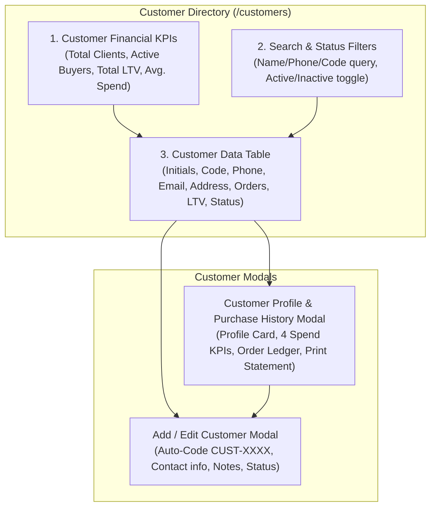

---

### Feature Breakdown

#### 1. Customer List
- **Executive Summary KPI Cards**:
  - **Total Customers**: Count of registered customer profiles and count of active accounts.
  - **Active Buyers**: Customers with $\ge 1$ recorded purchase, displaying buyer conversion percentage:
    $$\text{Conversion Rate} = \left(\frac{\text{Active Buyers}}{\text{Total Customers}}\right) \times 100\%$$
  - **Lifetime Value (LTV)**: Aggregated sales revenue generated across all customer accounts, formatted in dual currencies (USD and counterpart $\approx \text{KHR}$).
  - **Avg. Spend / Customer**: Average cumulative spend per active buying customer:
    $$\text{Average Spend} = \frac{\text{Total Customer LTV}}{\text{Active Buyers}}$$
- **Search & Filters**:
  - Live search input matching customer name, phone number, or customer code.
  - Status toggle buttons (`All`, `Active`, `Inactive`).
  - Refresh button with live spin indicator.
- **Data Table Columns**:
  - **Customer**: Initials avatar badge, Customer Full Name, and monospace Customer Code (`CUST-0001`).
  - **Contact Info**: Phone number (with `tel:` link) and Email address (with `mailto:` link).
  - **Location / Address**: Truncated address preview with location icon.
  - **Orders**: Rounded pill badge showing total completed orders (e.g. `5 orders`).
  - **Lifetime Spend**: Bold cumulative spend formatted in USD with counterpart KHR equivalent.
  - **Status**: Status badge pill (`ACTIVE` in emerald, `INACTIVE` in slate).
  - **Actions**:
    - `History` (eye icon): Opens Customer Profile & Purchase History modal.
    - `Edit` (pencil icon): Opens the Edit Customer modal.

#### 2. Customer Details
- **Profile Header**:
  - Large gradient initials avatar badge.
  - Full Name, Monospace Customer Code, and Status badge.
  - Member Since registration date.
  - Action buttons: `Print Statement` (`window.print()`), `Edit Profile`, and `Close`.
- **Contact & Location Grid**:
  - Phone Number, Email Address, Physical Address, and Line Notes/Remarks (e.g. VIP membership tier, special delivery instructions).
- **Customer Performance Metrics (4 KPI Cards)**:
  - **Total Orders**: Count of transactions completed by this customer.
  - **Total Spent**: Total money spent formatted in USD and counterpart KHR.
  - **Avg. Basket**: Average order value per purchase ($\text{Total Spent} / \text{Order Count}$).
  - **Last Order**: Date and store branch location of the customer's most recent checkout.

#### 3. Purchase History
- **Itemized Chronological Order Ledger (`GET /api/v1/customers/:customerId`)**:
  - Table of all orders linked to this customer code:
    - **Order #**: Monospace identifier (e.g. `ORD-2026-0001`).
    - **Date & Time**: Exact localized timestamp of checkout.
    - **Branch**: Store branch where sale was transacted.
    - **Status**: Badge pill (`COMPLETED` in emerald, `PENDING` in amber, `CANCELLED` in rose).
    - **Total Amount**: Highlighted total formatted in order currency with automatic counterpart conversion.
  - Empty state when no purchases have been recorded yet.
- **Printable Customer Statement**: Clean print layout optimized for browser printing or client account statements.

#### 4. Add / Edit Customer
- **Customer Code Generation**:
  - Auto-generated system sequence (`CUST-0001`, `CUST-0002`, etc.) if left blank upon creation.
  - Optional custom code entry for external loyalty identifiers or member card numbers.
- **Form Fields**:
  - **Full Name** *(Required)*: Client full name.
  - **Phone Number** *(Optional)*: Contact phone number.
  - **Email Address** *(Optional)*: Valid email format.
  - **Physical Address** *(Optional)*: Street and province address.
  - **Notes / Remarks** *(Optional)*: Loyalty notes, credit terms, or customer preferences.
  - **Status** *(Edit mode)*: Toggle between `ACTIVE` and `INACTIVE`.

---

### Backend API Reference

- **Routes**:
  - `GET /api/v1/customers`: List customer profiles with search query, order count (`_count.orders`), and recent orders.
  - `POST /api/v1/customers`: Create a new customer profile with auto-code or custom code.
  - `GET /api/v1/customers/:customerId`: Retrieve detailed customer record with full purchase order history.
  - `PATCH /api/v1/customers/:customerId`: Update customer contact info, address, notes, and active status.
- **RBAC Guards**:
  - View customer records & purchase histories: `requirePermission('customers.view')`
  - Create and update customer records: `requirePermission('customers.manage')`

---

### 1.8 Finance (`/finance`)

The Finance module is the central cashflow management, expenditure tracking, and P&L control hub for store managers and accountants. It consolidates retail sales revenues, customer refunds, non-retail additional incomes, branch operational expenses, and supplier purchase disbursements into an interactive executive dashboard and an append-only audit ledger.

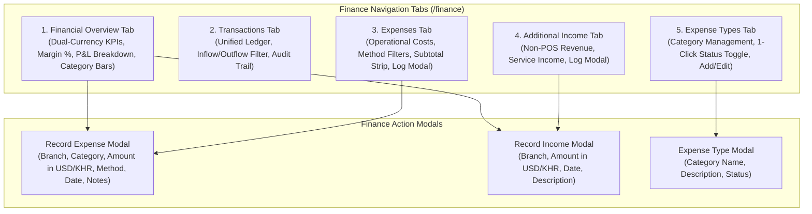

---

### Feature Breakdown

#### 1. Financial Overview
- **Executive Cashflow KPI Cards (4 Cards with Dual Currency)**:
  - **Net Sales Revenue**: Retail sales net of refunds ($\text{Gross Sales} - \text{Refunds}$), formatted in primary currency with counterpart conversion (`≈ ៛XXX,XXX` or `≈ $XX.XX`).
  - **Additional Income**: Non-retail business revenue (delivery fees, rebates, scrap sales, services), displaying total cumulative cash inflow.
  - **Operating Expenses**: Branch operational costs (rent, utilities, salaries, supplies, logistics), highlighting supplier purchase procurement liabilities.
  - **Operating Net Cashflow**:
    $$\text{Operating Net Cashflow} = (\text{Net Sales} + \text{Additional Income}) - \text{Operating Expenses}$$
    - Color-coded: Emerald for positive net cashflow, rose for deficit.
    - Operating Margin Percentage badge:
      $$\text{Margin} = \left(\frac{\text{Net Cashflow}}{\text{Total Inflow}}\right) \times 100\%$$
    - Subtext displaying **Net Cash Position (After Supplier Payments)**.
- **Quick Date Filter Presets**:
  - `Today`: Instant filter for active day's cash movements.
  - `Last 7 Days`: Trailing 7-day velocity.
  - `Last 30 Days`: Monthly trend comparison.
  - `This Month`: Month-to-date calendar view.
  - `All Time`: Full operational scope.
- **Branch Scope Selector**:
  - `Current Branch`: Filters financial metrics strictly to the selected store location.
  - `All Branches (Consolidated)`: Multi-branch business consolidated statement.
- **Financial Performance & Cashflow Statement (P&L Breakdown Table)**:
  - Formatted executive statement itemizing:
    1. **Cash Inflows**: Gross Retail Sales, Less: Customer Returns & Refunds, Net Sales Revenue, Additional Operating Income, and Total Cash Inflow.
    2. **Cash Outflows**: Branch Operating Expenses, Supplier Purchase Payments, and Total Cash Outflow.
    3. **Net Bottom-Line**: Operating Net Cashflow, Net Position (After Purchases), and Cashflow Margin %.
  - 1-click `Print Statement` button (`window.print()`).
- **Expense Breakdown by Category**:
  - Visual ranking of expense categories (Electricity, Rent, Staff Meals, Supplies, Packaging, Logistics).
  - Progress bars proportional to highest spending category.
  - Expense count badge (e.g. `12 records`) and total amount in base currency.

#### 2. Expenses
- **Store-Level Operational Cost Tracking (`GET /api/v1/finance/expenses`)**:
  - Filterable by Branch, Expense Type dropdown, Payment Method (`CASH`, `ABA KHQR`, `ACLEDA`, `BANK_TRANSFER`, `CHEQUE`), Date Range, and Search.
  - Data table columns: Expense Number (`EXP-0001`), Date, Branch, Type badge, Description, Payment Method badge, Amount (with bold primary currency and secondary counterpart conversion), and Logging Employee.
  - Table footer summary strip calculating total filtered expenses count and aggregate spend in USD and KHR.
- **Record Expense Modal (`POST /api/v1/finance/expenses`)**:
  - Inputs: Active Branch, Expense Category dropdown, Amount, Currency (`USD` / `KHR`), Payment Method, Date picker, and Description / Reference.
  - Enforces `finance.manage` permission.

#### 3. Expense Types
- **Category Catalog Management (`GET /api/v1/finance/expense-types`)**:
  - Standardized organizational classification for operational accounting.
  - Table columns: Name, Description, Logged Expenses Count, Status badge (`ACTIVE` in emerald, `INACTIVE` in slate), and Actions.
  - **1-Click Status Toggle**: Quick action button to toggle category status between `ACTIVE` and `INACTIVE` without opening dialogs.
  - **Add / Edit Expense Type Modal (`POST / PATCH /finance/expense-types`)**:
    - Category Name (unique per tenant).
    - Description.
    - Status toggle (`ACTIVE` / `INACTIVE`).

#### 4. Additional Income
- **Non-Retail Revenue Tracking (`GET /api/v1/finance/incomes`)**:
  - Records miscellaneous income outside regular retail POS checkout (e.g. supplier rebates, equipment rental, recycling, scrap carton sales, consulting/service fees).
  - Filterable by Branch, Date Range, and Search.
  - Data columns: Income Number (`INC-0001`), Date, Branch, Description, Amount (with dual currency USD + KHR), and Operator Employee.
  - Table footer summary strip showing total records and aggregate income in USD and KHR.
- **Record Income Modal (`POST /api/v1/finance/incomes`)**:
  - Inputs: Active Branch, Amount, Currency (`USD` / `KHR`), Date, and Description.

#### 5. Unified Financial Transactions
- **Complete Cashflow Ledger (`GET /api/v1/finance/transactions`)**:
  - Aggregates all financial movements across 5 distinct transaction types into a unified ledger:
    1. `SALE_PAYMENT` (Inflow): POS retail order checkouts.
    2. `SALE_RETURN` (Outflow): Customer refund disbursements.
    3. `ADDITIONAL_INCOME` (Inflow): Non-POS miscellaneous receipts.
    4. `EXPENSE` (Outflow): Branch operational expenditures.
    5. `PURCHASE_PAYMENT` (Outflow): Vendor procurement disbursements.
  - 3 Summary KPI Cards: Filtered Inflow, Filtered Outflow, and Net Flow with dual-currency conversions.
  - Search across document reference, category, description, branch, and cashier/operator.
  - Flow filter (`All`, `Inflow (+)` green, `Outflow (-)` rose).

---

### Backend API Reference

- **Routes**:
  - `GET /api/v1/finance/summary`: Aggregated P&L metrics, net sales, refund deductions, additional incomes, expense categories, and net cashflow.
  - `GET /api/v1/finance/transactions`: Unified append-only transaction ledger with direction, type, and method filters.
  - `GET /api/v1/finance/expenses`: Filtered list of branch operational expenses.
  - `POST /api/v1/finance/expenses`: Create branch expense record with document numbering sequence (`EXP-XXXX`).
  - `GET /api/v1/finance/incomes`: Filtered list of non-retail additional incomes.
  - `POST /api/v1/finance/incomes`: Record non-retail additional income with document sequence (`INC-XXXX`).
  - `GET /api/v1/finance/expense-types`: List expense categories with linked expense counts.
  - `POST /api/v1/finance/expense-types`: Create expense category.
  - `PATCH /api/v1/finance/expense-types/:expenseTypeId`: Update expense category name, description, or status.
- **RBAC Guards**:
  - View financial reports, summaries, and ledgers: `requirePermission('finance.view')`
  - Create and manage expenses, incomes, and categories: `requirePermission('finance.manage')`

---

### 1.9 Shifts (/shifts)

Cash Drawer Shift Management is the core cash custody, session control, and cashier reconciliation interface for retail store operations. It tracks opening floats, live cash drawer inflows and outflows (sales and returns), expected cash, physical drawer counts at end-of-shift, and discrepancy auditing (overages and shortages).

---

### Key Sections & Component Architecture

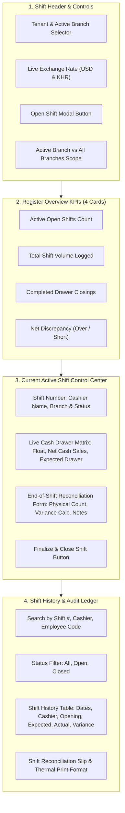

---

### Detailed Feature Breakdown

#### 1. Current Shift Control Center
- **Live Active Session Detection**:
  - Queries `GET /api/v1/shifts/current` on page load to detect if the logged-in employee currently has an open drawer session at the active branch.
  - If an active shift exists, surfaces an emerald-highlighted Hero Control Center displaying shift number (`SHF-XXXX`), cashier details, start time, and elapsed shift duration timer.
  - If no active shift exists, renders a clear callout prompting the cashier to count their starting cash and click **"Open Shift"** before proceeding to POS checkouts.
- **Live Cash Drawer Matrix**:
  - **Starting Float**: Opening cash verified at start of shift (`openingCash`) with dual-currency conversion.
  - **Net Cash Inflow**: Dynamic calculation of cash retained from retail transactions:
    $$\text{Net Cash Inflow} = \text{Cash Sales} - \text{Cash Refunds}$$
  - **Expected Drawer Cash**: Dynamic system balance that should physically exist inside the cash drawer:
    $$\text{Expected Cash} = \text{Opening Float} + \text{Net Cash Inflow}$$
- **POS Lockout Guard**:
  - Cashiers without an open shift session receive a prompt redirecting them to `/shifts` before processing sales in `/pos`, ensuring 100% auditable cash tracking.

#### 2. Close Shift & End-of-Day Cash Reconciliation
- **Physical Drawer Count Input**:
  - The cashier enters the physically counted paper cash and coins in the drawer (`actualCash`).
  - Supports quick-fill with expected cash button for accelerated closing when drawer matches.
- **Real-Time Discrepancy & Variance Calculator**:
  - Automatically calculates cash variance as the cashier types:
    $$\text{Discrepancy} = \text{Actual Cash} - \text{Expected Cash}$$
  - Visual status classification:
    - **Balanced** ($\text{Difference} = 0$): Slate/neutral badge indicating a perfect drawer count.
    - **Cash Overage** ($\text{Difference} > 0$): Emerald alert indicating surplus cash in drawer.
    - **Cash Shortage** ($\text{Difference} < 0$): Crimson alert indicating missing cash requiring management review.
- **Supervisor Closing Notes**:
  - Textarea allowing the cashier or supervisor to document reasons for discrepancies (e.g. counterfeit bill withheld, till discrepancy, unrecorded petty cash payout).
- **Finalize Shift Execution**:
  - Submits to `POST /api/v1/shifts/:shiftId/close`, sealing the session, setting `closedAt`, and writing the discrepancy to the permanent audit trail.

#### 3. Open Shift Modal
- **Drawer Opening Initialization (`POST /api/v1/shifts/open`)**:
  - Modal dialog with branch selector (defaults to current active branch).
  - Cash currency selector (`USD` or `KHR`).
  - Starting cash input with instant quick-select float presets:
    - USD Presets: `$50.00`, `$100.00`, `$150.00`, `$200.00`
    - KHR Presets: `៛200,000`, `៛400,000`, `៛600,000`, `៛800,000`
  - Validates non-negative float amounts.
  - Concurrency guard: prevents opening multiple shifts simultaneously for the same employee at the same branch.

#### 4. Shift History & Audit Ledger
- **Historical Drawer Sessions Table (`GET /api/v1/shifts`)**:
  - Displays complete chronological shift ledger across all cashiers and branches.
  - Columns:
    1. **Shift Number**: Monospace badge (e.g., `SHF-2026-0001`).
    2. **Cashier / Employee**: Avatar initials, full name, and employee code badge.
    3. **Branch**: Store location name and branch code.
    4. **Opened At**: Date and time shift was initiated.
    5. **Closed At**: Date and time shift was reconciled (or `"In Progress"` badge for open shifts).
    6. **Opening Cash**: Starting float with USD & KHR counterpart conversion.
    7. **Expected Cash**: System calculated expected balance.
    8. **Actual Cash**: Physical count entered at closing (or `—` if open).
    9. **Variance / Discrepancy**: Color-coded pill (`Balanced`, `+$X.XX Over`, `-$X.XX Short`).
    10. **Orders**: Count of orders rung up during the session.
    11. **Actions**: One-click **"View Details"** button opening the reconciliation report slip modal.
- **Filtering & Search**:
  - Text search by shift number, cashier name, employee code, or branch name.
  - Status filter tabs: `All Shifts`, `Open`, `Closed`.
  - Branch scope toggle: `Current Active Branch` vs `All Branches` (for store managers and owners).

#### 5. Shift Reconciliation Report & Printable Slip Modal
- **Comprehensive Audit Breakdown Modal (`GET /api/v1/shifts/:shiftId`)**:
  - Detailed financial reconciliation view showing:
    - Session metadata: Shift ID, cashier name, branch, open time, close time, duration.
    - Cash drawer summary: Opening float, expected cash, actual counted cash, net difference.
    - Tender type breakdown: Total cash payments vs digital payments (ABA KHQR, ACLEDA, Cards).
    - Transaction list: Order number, time, customer, tender method, and total amount.
- **Printable Thermal Reconciliation Slip**:
  - 1-click **"Print Slip"** button triggering browser `window.print()` formatted with clean thermal slip styling (store title, cashier name, float, sales total, expected, actual, variance, cashier signature line, manager signature line).

---

### Backend API Reference

- **Routes**:
  - `GET /api/v1/shifts/current`: Returns the active open shift for the authenticated employee and branch context.
  - `GET /api/v1/shifts`: Paginated shift audit ledger filterable by `branchId`, `status` (`OPEN` / `CLOSED`), and date range.
  - `GET /api/v1/shifts/:shiftId`: Returns full shift details including nested orders, payment methods, and cashier metadata.
  - `POST /api/v1/shifts/open`: Creates a new shift record with `openingCash`, `status: OPEN`, and auto-generated shift number sequence (`SHF-XXXX`).
  - `POST /api/v1/shifts/:shiftId/close`: Closes the shift, verifies expected cash, records `actualCash` and `cashDifference`, sets `status: CLOSED`, and commits closing timestamp.
- **RBAC Guards**:
  - View shift records and current status: `requirePermission('shifts.view')`
  - Open new shifts, record counts, and close shifts: `requirePermission('shifts.manage')`

---

### 1.10 Reports & Analytics (`/reports`)

The Reports & Business Intelligence module delivers deep operational visibility, inventory valuation, financial performance, cashier audit trails, and predictive merchandising intelligence. It spans standard retail summaries, formal financial accounting (P&L, Balance Sheet, Tax/VAT), and Version 2 advanced data analytics.

---

### Key Sections & Component Architecture

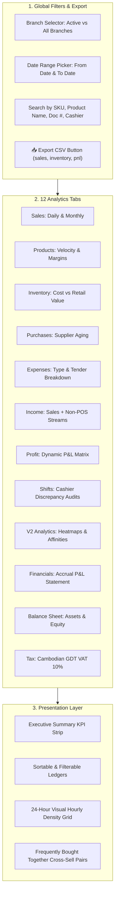

---

### Detailed Feature Breakdown

#### 1. Daily & Monthly Sales Report (`GET /api/v1/reports/sales`)
- **Executive KPI Strip (5 Metrics)**:
  - **Orders**: Total count of completed retail transactions.
  - **Gross Sales**: Aggregated gross sales prior to return deductions with dual-currency counter-value.
  - **Total Refunds**: Cumulative customer returns and refunds processed.
  - **Net Sales**: Retained sales revenue: $\text{Net Sales} = \text{Gross Sales} - \text{Total Refunds}$.
  - **Total Discounts**: Aggregate value of order-level and line-item discounts granted.
- **Daily Sales Ledger Table**:
  - Date, completed order count, gross total, refunded total, and net daily revenue.
- **Monthly Trend Table**:
  - Month name, order count, gross sales, refunds, and retained revenue for month-over-month trajectory.
- **Payment Method Distribution Breakdown**:
  - Transaction count and dollar/riel volume split across tender types: Cash, ABA KHQR, ACLEDA, and Other Cards.

#### 2. Product Performance & Margin Analysis (`GET /api/v1/reports/products`)
- **Executive Summary**:
  - Total Catalog Revenue, Total Cost of Goods Sold (COGS), Total Profit, and Blended Margin %.
- **Product Velocity & Profitability Ledger**:
  - Real-time search filter across product name and SKU.
  - Columns: Product Name, SKU, Quantity Sold, Total Revenue Generated, Cost of Goods, Gross Profit Dollar Value, and Profit Margin %:
    $$\text{Margin } \% = \left(\frac{\text{Profit}}{\text{Revenue}}\right) \times 100\%$$
  - Visual status pill: High Margin (>40% emerald), Moderate (15-40% blue), Low (<15% amber/rose).

#### 3. Inventory Valuation & Stock Health (`GET /api/v1/reports/inventory`)
- **Valuation KPI Summary**:
  - **Total Cost Valuation**: Aggregate value of on-hand inventory at procurement cost.
  - **Total Retail Valuation**: Expected realization value of on-hand stock at retail price.
  - **Total Units on Hand**: Cumulative inventory units across all products and branches.
  - **Low Stock Alert Count**: Critical restock threshold counter.
- **Inventory Matrix Table**:
  - Filterable with a 1-click **"Low Stock Only"** toggle.
  - Columns: Product Name, Branch, SKU, Current Quantity On Hand, Low-Stock Alert Threshold, Stock Health Badge (`CRITICAL`, `LOW`, `HEALTHY`), Cost Valuation, and Retail Valuation.

#### 4. Purchase Procurement & Supplier Aging (`GET /api/v1/reports/purchases`)
- **Procurement KPI Cards**:
  - Total POs Created, Orders Received into Inventory, Total Procurement Cost, Total Amount Disbursed, and Outstanding Supplier Balance Due.
- **Purchase Order Ledger**:
  - Order Status filter (`All`, `ORDERED`, `RECEIVED`).
  - Columns: Purchase Number (`PUR-XXXX`), Supplier Name, Destination Branch, PO Date, Total PO Value, Amount Paid, Remaining Balance Due, Order Fulfillment Status, and Payment Status (`UNPAID`, `PARTIAL`, `PAID`).

#### 5. Operating Expense Report (`GET /api/v1/reports/expenses`)
- **Expense Summaries**: Total Operating Expenses and Total Logged Expense Transactions.
- **Categorical Breakdown**: Aggregate spending and receipt count grouped by expense type (Rent, Utilities, Staff Meals, Logistics, Supplies).
- **Disbursement Method Breakdown**: Cash, Bank Transfer, Petty Cash.
- **Itemized Expense Audit Ledger**: Searchable by expense number, cashier/employee, and description.

#### 6. Additional Income Streams (`GET /api/v1/reports/incomes`)
- **Income Summaries**: Gross POS Sales, Net POS Sales, Non-POS Additional Income (rebates, rentals, scrap sales), and Combined Total Cash Inflow.
- **Daily Inflow Matrix**: Correlates retail POS cash receipts with non-retail miscellaneous receipts.
- **Itemized Income Ledger**: Document number, originating branch, operator name, description, and dual-currency amount.

#### 7. Profit Estimation & Dynamic P&L Matrix (`GET /api/v1/reports/profit`)
- **Executive Margins Breakdown**:
  - Gross Sales, Customer Returns, Net Sales Revenue.
  - Cost of Goods Sold (COGS).
  - Gross Profit & Gross Margin %.
  - Operational Expenses & Miscellaneous Additional Incomes.
  - **Estimated Net Profit** & **Net Margin %**:
    $$\text{Net Margin } \% = \left(\frac{\text{Estimated Net Profit}}{\text{Net Sales}}\right) \times 100\%$$
- **Daily Profit Trajectory Ledger**:
  - Date, Net Sales, COGS, Additional Income, Operational Expenses, Estimated Daily Profit, and Daily Margin %.

#### 8. Employee Performance & Cashier Auditing Report (`GET /api/v1/reports/employees`)
- **Staff Performance KPI Strip (5 Metrics)**:
  - **Total Staff**: Count of registered employees in the organization.
  - **Active Cashiers**: Number of employees who processed $\ge 1$ sales order within the selected timeframe.
  - **Orders Handled**: Cumulative count of transactions processed by cashier staff.
  - **Total Sales Volume**: Aggregate revenue generated by staff with dual-currency counter-value.
  - **Top Performer Badge**: Identifies the highest-grossing staff member, dollar volume, and order velocity.
- **Employee Performance Ledger Table**:
  - Employee Code, Avatar & Name, Position (e.g. *"Cashier"*, *"Store Manager"*), Assigned Branches, Orders Handled, Total Sales (with DualAmount USD/KHR), Average Order Value (AOV / Basket Size), Total Discounts Granted, Shifts Completed, Cash Drawer Discrepancy ($\pm$ Over/Short), and Performance Tier Badge (`Top Tier`, `High Producer`, `Active`, `Standby`).

#### 9. Cashier Shift Auditing Report (`GET /api/v1/reports/shifts`)
- **Drawer Audit Summary**:
  - Total Shifts, Active Open Sessions, Closed Reconciled Sessions.
  - Total Opening Float, Total Shift Sales Volume, Expected Drawer Cash, Counted Actual Cash, and Cumulative Discrepancy.
- **Cashier Reconciliation Matrix Table**:
  - Shift Number (`SHF-XXXX`), Cashier Name & Code, Branch Name, Status, Orders Count, Sales Total, Opening Float, Expected Drawer, Counted Actual, Variance ($\pm$), and Opened/Closed Timestamps.

#### 10. Advanced Version 2 Analytics
- **24-Hour Sales Density & Staffing Heatmap (`GET /api/v1/reports/analytics/hourly-heatmap`)**:
  - Visual 24-column grid (00:00 to 23:00) mapping order frequency and revenue concentration throughout the day.
  - Identifies peak trading windows (e.g. 12:00 lunch rush or 18:00 evening peak) to inform smart cashier scheduling and inventory staging.
  - Color-coded intensity: Low (slate), Moderate (light blue), High (vibrant blue), Peak (navy/white).
- **Market Basket Product Affinity (`GET /api/v1/reports/analytics/product-affinity`)**:
  - Analyzes transaction baskets to discover **"Frequently Bought Together"** product pairings.
  - Computes co-occurrence order count and pairing strength.
  - Surfaces high-probability cross-sell recommendations for POS promotional bundles.
- **Customer Retention & Cohort Analytics (`GET /api/v1/reports/analytics/customer-retention`)**:
  - Tracks customer loyalty and purchasing habits.
  - Computes Repeat Customer Rate:
    $$\text{Repeat Rate } \% = \left(\frac{\text{Repeat Customers}}{\text{Total Tracked Customers}}\right) \times 100\%$$
  - Classifies customer tiers: One-time buyers, Returning buyers, VIP champions.

#### 10. Financial Statements (Version 2)
- **Formal Accrual Profit & Loss Statement (P&L) (`GET /api/v1/reports/financial/pnl`)**:
  - Structured GAAP/IFRS formatted income statement:
    - Gross Sales Revenue
    - Less: Sales Returns & Customer Refunds
    - **Net Sales Revenue**
    - Less: Cost of Goods Sold (COGS)
    - **Gross Profit (Gross Margin %)**
    - Operating Expenses Breakdown (itemized by category)
    - Total Operating Expenses
    - **Operating Profit**
    - Plus: Additional Business Income
    - **Net Profit (Net Margin %)**
- **Balance Sheet Statement (`GET /api/v1/reports/financial/balance-sheet`)**:
  - Real-time financial snapshot divided into 3 accounting pillars:
    1. **Current Assets**: Cash in Registers + Total Inventory Valuation at Cost = Total Current Assets.
    2. **Current Liabilities**: Supplier Accounts Payable (outstanding procurement balances).
    3. **Business Net Equity**: Assets minus Liabilities.
- **Cambodia GDT Tax & VAT Declaration (`GET /api/v1/reports/financial/tax-summary`)**:
  - Designed for General Department of Taxation (GDT) Cambodia Value-Added Tax compliance:
    - **Output VAT (Sales)**: Taxable sales base and 10% collected sales VAT.
    - **Input VAT (Purchases)**: Taxable purchases base and 10% procurement VAT credit.
    - **Net VAT Liability**: Calculated net tax payable to the GDT ($\text{Output VAT} - \text{Input VAT}$).

#### 11. Multi-Format Data Exporting Engine
- **Direct CSV Download (`GET /api/v1/reports/export`)**:
  - Supports report export parameter `?type=sales|inventory|pnl`.
  - Streams UTF-8 RFC-4180 compliant CSV files with formatted columns, dual-currency amounts, and date filters applied.

---

### Backend API Reference

- **Routes**:
  - `GET /api/v1/reports/sales`: Sales KPIs, daily sales, monthly sales, and payment method distribution.
  - `GET /api/v1/reports/products`: Product sales velocity, cost of goods, revenue, and gross profit margins.
  - `GET /api/v1/reports/inventory`: Valuation of on-hand inventory at cost and retail, with low-stock status.
  - `GET /api/v1/reports/purchases`: Procurement metrics, vendor payables, and order fulfillment status.
  - `GET /api/v1/reports/expenses`: Categorical and payment method breakdowns of operational expenditures.
  - `GET /api/v1/reports/incomes`: Combined sales and non-POS additional income ledger.
  - `GET /api/v1/reports/profit`: P&L estimates, COGS, operating profit, and daily net margins.
  - `GET /api/v1/reports/shifts`: Cashier shift audit summaries and till discrepancy records.
  - `GET /api/v1/reports/employees`: Staff sales volume, order counts, cashier shifts, discounts, and performance metrics.
  - `GET /api/v1/reports/analytics/hourly-heatmap`: 24-hour trading velocity distribution.
  - `GET /api/v1/reports/analytics/product-affinity`: Market basket co-occurrence analytics and bundles.
  - `GET /api/v1/reports/analytics/customer-retention`: Customer repeat buyer rates and purchase frequency.
  - `GET /api/v1/reports/financial/pnl`: Structured formal Profit & Loss income statement.
  - `GET /api/v1/reports/financial/balance-sheet`: Current assets, liabilities, and business net equity.
  - `GET /api/v1/reports/financial/tax-summary`: Cambodia GDT VAT 10% declaration summary.
  - `GET /api/v1/reports/export`: Direct CSV file export for sales, inventory, employees, and P&L.
- **RBAC Guards**:
  - View reports and analytics: `requirePermission('reports.view')`

---

### 1.11 Settings & Business Administration (`/settings/*`)

The Settings hub empowers business owners and administrators to configure core business metadata, multi-branch network topology, fiscal and taxation rules, thermal receipt styling, document numbering schemes, subscription tiering, active user sessions, and enterprise-grade audit logging.

The master entry point at `/settings` serves as a centralized Command Center with 4 overview cards (Business Identity, Active Branches, Dual Currency Engine, Tax & Language) and 8 specialized management module cards with 1-click navigation via the top `<SettingsNav />` bar across all configuration views.

---

### Key Sections & Component Architecture

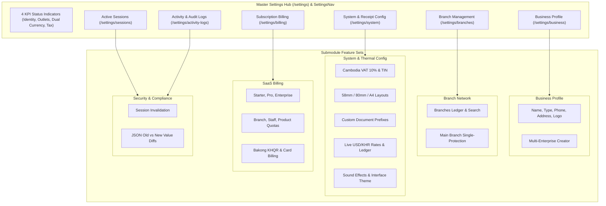

---

### Detailed Feature Breakdown

#### 1. Business Profile (`/settings/business`)
- **Tenant Metadata Management (`GET / PATCH /api/v1/tenants/current`)**:
  - **Company Profile**: Business Legal Name, Business Type (Retail, Restaurant, Pharmacy, Mart, Cafe, Service, Wholesale), Corporate Email, Phone Number, Physical Address, and Brand Logo URL.
  - **Localization Defaults**: Base Default Currency (`USD` or `KHR`), System Language (`English` or `Khmer`), and Timezone (`Asia/Phnom_Penh`).
- **Multi-Business Enterprise Creator (`POST /api/v1/tenants`)**:
  - Allows single-account enterprise owners to launch and operate multiple independent businesses under one login credential.
  - Requires: New Business Name, Business Type, Default Currency, and Language.
  - Automatically provisions the new tenant's main branch, owner role assignment, and default exchange rate.

#### 2. Multi-Branch Management (`/settings/branches`)
- **Store Network Operations (`GET /api/v1/branches`)**:
  - Full branch location ledger with real-time text search.
  - Columns: Branch Name, Branch Code (e.g. `MAIN`, `SR-01`), Contact Phone, Address, Main Branch status badge (`Main Branch` with gold star), and Action buttons.
- **Add / Edit Branch Modal (`POST / PATCH /api/v1/branches`)**:
  - Inputs: Branch Name, Unique Branch Code, Phone Number, Physical Address, and **"Set as Main Branch"** toggle.
- **Main Branch Inviolability Guard**:
  - The system enforces a strict single-main-branch constraint: designating a new main branch atomically transfers the main flag from the previous main branch.
  - Deleting or archiving the main branch is strictly prevented by API validation guards.

#### 3. System Settings, Tax & Thermal Receipt Customization (`/settings/system`)
The system settings page provides a unified 5-tab interface:
- **Tab 1: Tax & VAT Configuration**:
  - **Cambodian VAT 10% Compliance**: Toggle Value-Added Tax on/off, configure default tax percentage (default 10.00%), select Tax Inclusive vs Tax Exclusive pricing models.
  - **Tax Identification Number (TIN)**: Official Cambodian tax registration number printed on formal receipts for tax deduction claims.
- **Tab 2: Thermal Receipt Customization**:
  - **Paper Format Selection**: Presets for `58mm` compact mobile/Bluetooth roll, `80mm` standard countertop POS roll, and `A4` full invoice format.
  - **Typography & Font Scale**: Select between Small (high-density items), Medium (standard thermal), and Large (high readability).
  - **Branding & Store Messaging**: Store logo, custom header greeting, thank-you footer, return & exchange policy text, customer WiFi credentials, and social media/Telegram handles.
  - **Metadata & Feature Toggles**: Show/hide Cashier Name, Customer Name & VIP tier, Tax details & VATTIN, Product Categories, Customer Savings badge, and printable barcode graphic.
  - **Live Preview & Test Print**: Real-time visual receipt mockup updating dynamically with a 1-click **"Test Print"** button that invokes thermal browser printer styling.
- **Tab 3: Document Numbering Sequences**:
  - Custom sequence prefixes with real-time format previews:
    - Sales Orders: `ORD-` (e.g. `ORD-2026-0001`)
    - Purchase Orders: `PUR-` (e.g. `PUR-2026-0001`)
    - Sale Returns: `RET-` (e.g. `RET-2026-0001`)
    - Stock Transfers: `TRF-` (e.g. `TRF-2026-0001`)
    - Expenses: `EXP-` (e.g. `EXP-2026-0001`)
    - Additional Incomes: `INC-` (e.g. `INC-2026-0001`)
    - Cashier Shifts: `SHF-` (e.g. `SHF-2026-0001`)
- **Tab 4: Dual-Currency Exchange Rate Engine**:
  - Base currency pair configuration (`USD` $\leftrightarrow$ `KHR`).
  - Update live conversion rate (e.g. `1 USD = 4,100 KHR`).
  - Historical rate audit trail table with effective date and creator.
  - **Interactive Currency Converter Widget**: Bidirectional calculator instantly converting any USD dollar amount to Khmer Riel and vice versa using the active tenant rate.
- **Tab 5: Cashier Audio & Workspace Preferences**:
  - **Sound Effects**: Toggle audio feedback for barcode scanner beeps, checkout complete success fanfare, and error alerts.
  - **Theme Preference**: Light, Dark, or System mode.
  - **Interface Language**: Instant switch between English and Khmer (ភាសាខ្មែរ).

#### 4. Subscription Billing & Plans (`/settings/billing`)
- **Current Plan Status & Quota Meters (`GET /api/v1/billing/subscription`)**:
  - Displays current plan tier (`FREE_TRIAL`, `STARTER`, `PROFESSIONAL`, `ENTERPRISE`), renewal date, and billing cycle.
  - Real-time visual progress bars tracking resource consumption against plan limits:
    - **Branches Quota**: e.g., 2 / 5 branches used.
    - **Staff / Employees Quota**: e.g., 8 / 20 employees used.
    - **Catalog Products Quota**: e.g., 450 / 2,000 SKUs used.
- **Plan Comparison Matrix & Upgrade Controls (`GET /api/v1/billing/plans`)**:
  - Tier cards detailing monthly vs yearly pricing (with 2 months free discount for annual commitments).
  - Feature entitlement checklist per tier (PWA offline sync, multi-branch transfers, advanced analytics exports, Bakong automated payments).
  - 1-click **"Upgrade Plan"** or **"Switch to Yearly"** action (`POST /api/v1/billing/subscription/change`).
- **Automated Payment Integrations**:
  - Supports automated subscription renewals via **Bakong KHQR** dynamic QR push-notifications and credit/debit card processing.
- **Invoices & Billing History Ledger**:
  - Downloadable receipts table detailing invoice number, billing period, amount, currency, payment status (`PAID`), and payment date.

#### 5. Active User Sessions (`/settings/sessions`)
- **Session Security Matrix (`GET /api/v1/auth/sessions`)**:
  - Complete list of active login sessions for the current authenticated user across desktop, mobile, and tablets.
  - Displays: Device Icon, Browser User-Agent, Operating System, IP Address, Sign-in Timestamp, and Last Active time.
  - Identifies *"Current Session"* badge.
- **Remote Session Revocation (`DELETE /api/v1/auth/sessions/:sessionId`)**:
  - 1-click **"Revoke"** button allowing cashiers or owners to remotely terminate compromised or forgotten sessions immediately.

#### 6. Activity & Security Audit Logs (`/settings/activity-logs`)
- **Comprehensive Tenant Activity Feed (`GET /api/v1/activity-logs`)**:
  - Append-only audit trail logging every critical action across 14 system modules: `sales`, `purchasing`, `inventory`, `products`, `suppliers`, `finance`, `shifts`, `branches`, `roles`, `employees`, `settings`, `tenants`, `auth`.
  - Filter by Module dropdown, Action filter (`CREATE`, `UPDATE`, `DELETE`, `CANCEL`, `LOGIN`, `STATUS_CHANGE`), Actor user name, and Date Range.
- **Deep Inspection Diff Modal**:
  - Clicking any log entry opens a detailed side-by-side inspection dialog showing:
    - Actor Name, Email, IP Address, Timestamp.
    - Target Resource ID & Entity Type.
    - **Field-by-Field Diff**: Highlights modified keys showing `Old Value` in rose and `New Value` in emerald.
    - **Raw JSON Inspector**: Toggle to view complete payload snapshots for developer or compliance audits.

---

### Backend API Reference

- **Routes**:
  - `GET /api/v1/tenants/current`: Retrieve active business profile and settings.
  - `PATCH /api/v1/tenants/current`: Update company name, type, contact info, logo, currency, language, and timezone.
  - `POST /api/v1/tenants`: Provision new enterprise business under current user.
  - `GET /api/v1/branches`: List all branches with main branch status.
  - `POST /api/v1/branches`: Create new branch location.
  - `PATCH /api/v1/branches/:branchId`: Update branch details or toggle main branch.
  - `GET /api/v1/settings`: Fetch system settings map and exchange rate history.
  - `PATCH /api/v1/settings`: Update tax rules, receipt configurations, and document sequence prefixes.
  - `POST /api/v1/settings/exchange-rates`: Record new active exchange rate.
  - `GET /api/v1/settings/user-preferences`: Retrieve personalized UI sound and display preferences.
  - `PATCH /api/v1/settings/user-preferences`: Save personalized UI preferences.
  - `GET /api/v1/billing/subscription`: Retrieve active plan, quotas, and invoice history.
  - `GET /api/v1/billing/plans`: List available subscription tiers and pricing.
  - `POST /api/v1/billing/subscription/change`: Switch plan tier or billing cycle.
  - `GET /api/v1/auth/sessions`: List active concurrent user sessions.
  - `DELETE /api/v1/auth/sessions/:sessionId`: Terminate specific session.
  - `GET /api/v1/activity-logs`: Filtered tenant audit logs with pagination and diffs.
- **RBAC Guards**:
  - View tenant profile, branches, settings: `requirePermission('tenant.view')`, `requirePermission('branches.view')`
  - Update settings, rates, tax, receipt formats: `requirePermission('tenant.update')`, `requirePermission('branches.update')`
  - View audit logs: `requirePermission('activity_logs.view')`

---

### 1.12 Employees & Access Control (`/access`)

The Employees & Access Control module administers staff identity, branch assignments, role-based access control (RBAC), and team onboarding. It ensures strict principle-of-least-privilege security across store cashiers, inventory clerks, store managers, and corporate accountants.

---

### Key Sections & Component Architecture

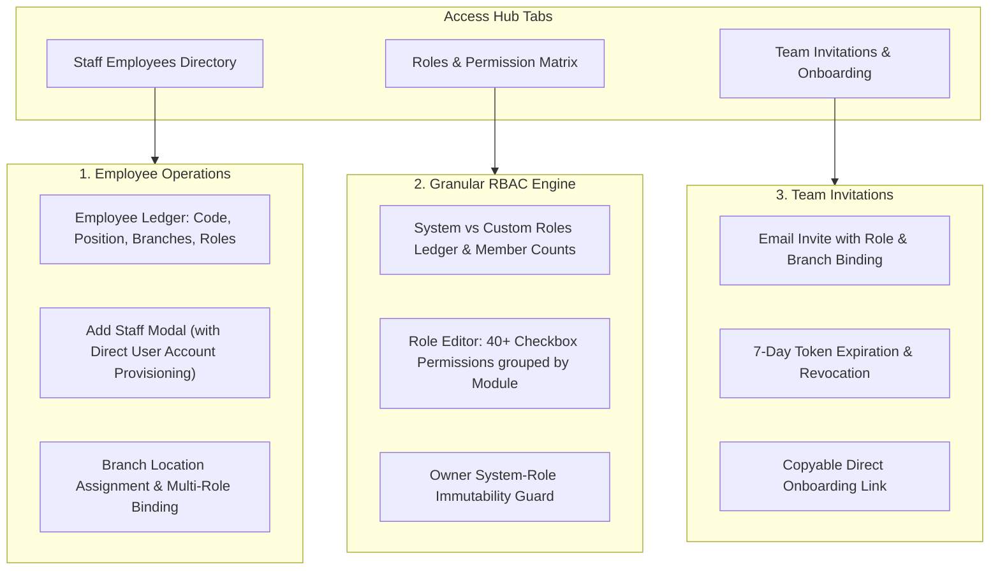

---

### Detailed Feature Breakdown

#### 1. Employees Directory (`/access` — Employees Tab)
- **Staff Roster Ledger (`GET /api/v1/access/employees`)**:
  - Displays all employees registered under the active tenant.
  - Columns:
    1. **Employee Code**: Monospace sequence identifier (e.g. `EMP-0001`).
    2. **Name & Contact**: Full name, phone number, and work email.
    3. **Position / Title**: Designated job title (e.g. *"Head Cashier"*, *"Stock Manager"*).
    4. **Assigned Branches**: Badges showing which store locations the employee is authorized to access (e.g., `Main Branch`, `Siem Reap Branch`).
    5. **Assigned Roles**: Colored badges displaying active permissions roles (e.g. `Cashier`, `Manager`).
    6. **Login Account**: Pill indicating whether employee possesses web login credentials (`Active User` in emerald vs `No Account` in slate).
    7. **Status**: Operational employment status (`ACTIVE` vs `INACTIVE`).
    8. **Actions**: Edit Staff button.
- **Add Employee Modal (`POST /api/v1/access/employees`)**:
  - Inputs: Employee Code (auto-suggested or custom), Full Name, Work Email, Phone Number, Job Position.
  - Initial Role Assignment dropdown.
  - Multi-Branch Assignment checkboxes.
  - **1-Click User Account Provisioning**: Checking *"Create login account for this employee"* surfaces a password input, atomically creating both the employee record and user login credentials.
- **Edit Employee Modal (`PATCH /api/v1/access/employees/:employeeId`)**:
  - Update employee title, assigned branches, and multi-role assignments (employees can hold multiple roles simultaneously, inheriting the union of permissions).

#### 2. Roles & Permissions Management (`/access` — Roles Tab)
- **Role Catalog (`GET /api/v1/access/roles`)**:
  - Table of configured tenant roles with member headcount.
  - Distinguishes between **System Roles** (e.g. `Owner`, `Manager`, `Cashier` — permanent structural roles) and **Custom Roles** (user-defined roles like `Shift Lead`, `Auditor`).
- **Create & Edit Role Modal (`POST / PATCH /api/v1/access/roles`)**:
  - Role Name and Description.
  - **Granular Permission Checkbox Matrix**: Permissions grouped by functional module:
    - **Sales & POS**: `sales.view`, `sales.create`, `sales.manage`
    - **Products & Catalog**: `products.view`, `products.create`, `products.update`, `products.delete`
    - **Inventory & Transfers**: `inventory.view`, `inventory.manage`, `inventory.transfer`
    - **Purchases & Suppliers**: `purchases.view`, `purchases.create`, `purchases.manage`
    - **Customers**: `customers.view`, `customers.manage`
    - **Finance**: `finance.view`, `finance.manage`
    - **Shifts & Registers**: `shifts.view`, `shifts.manage`
    - **Reports & Business Intelligence**: `reports.view`
    - **Settings & Branches**: `tenant.view`, `tenant.update`, `branches.view`, `branches.create`, `branches.update`
    - **Employees & Access**: `employees.view`, `employees.create`, `employees.update`, `roles.view`, `roles.manage`
    - **Security & Logs**: `activity_logs.view`
  - System Protection Guard: Built-in `Owner` role permissions are protected against accidental stripping.

#### 3. Team Invitations & Onboarding (`/access` — Invitations Tab)
- **Invitation Queue Ledger (`GET /api/v1/access/invitations`)**:
  - Records outbound invitations with destination email, assigned role, expiration timestamp, and status (`PENDING`, `ACCEPTED`, `EXPIRED`).
  - **Revoke Invitation Action (`DELETE /api/v1/access/invitations/:invitationId`)**: Instantly invalidates an outstanding invite token.
- **Send Invite Modal (`POST /api/v1/access/invitations`)**:
  - Enters invitee email address and selects the target role.
  - Automatically generates a cryptographically secure 7-day single-use token.
  - Generates a direct copyable link (`/accept-invitation?token=...`) allowing administrators to share invitations via internal messaging channels in addition to email.

---

### Backend API Reference

- **Routes**:
  - `GET /api/v1/access/employees`: List all tenant employees with branch and role relations.
  - `POST /api/v1/access/employees`: Create new employee with optional user account provisioning.
  - `PATCH /api/v1/access/employees/:employeeId`: Update employee metadata, branch access, and role bindings.
  - `GET /api/v1/access/roles`: List tenant roles, system flags, and member counts.
  - `POST /api/v1/access/roles`: Create custom tenant role with selected permission codes.
  - `PATCH /api/v1/access/roles/:roleId`: Update role name, description, and permissions.
  - `DELETE /api/v1/access/roles/:roleId`: Delete custom role (prevented if active members exist or if system role).
  - `GET /api/v1/access/permissions`: Retrieve complete system permission taxonomy.
  - `GET /api/v1/access/invitations`: List pending and past team invitations.
  - `POST /api/v1/access/invitations`: Issue new email invitation with role binding.
  - `DELETE /api/v1/access/invitations/:invitationId`: Invalidate pending invitation.
- **RBAC Guards**:
  - View staff and roles: `requirePermission('employees.view')`, `requirePermission('roles.view')`
  - Create and update employees: `requirePermission('employees.create')`, `requirePermission('employees.update')`
  - Manage roles and permissions: `requirePermission('roles.manage')`

---

### 1.13 Branch Stock Transfers (`/inventory/transfers`)

The Branch Stock Transfers module enables multi-location retail chains to balance inventory across physical stores, warehouses, and outlet locations. It implements a multi-step custody chain (`PENDING` $\rightarrow$ `IN_TRANSIT` $\rightarrow$ `COMPLETED`) with stock reservation guarantees that prevent overselling while goods are on the road.

---

### Key Sections & Component Architecture

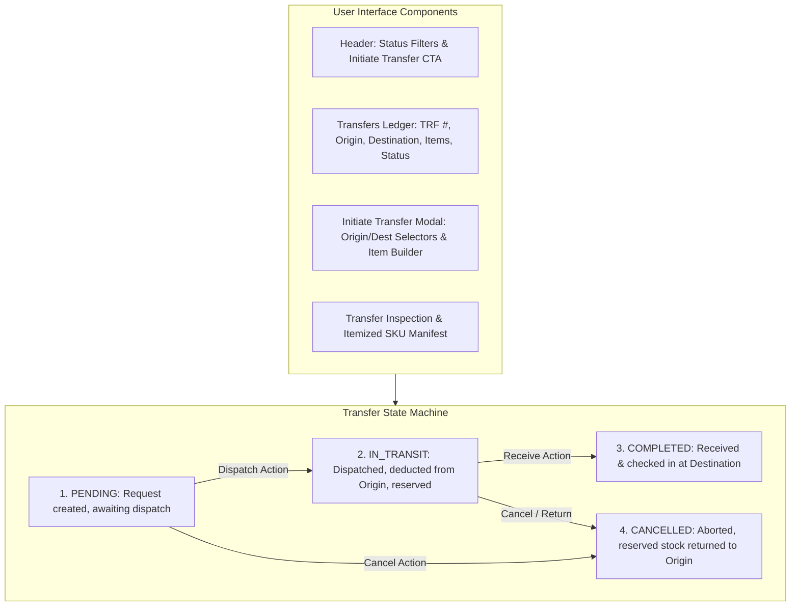

---

### Detailed Feature Breakdown

#### 1. Transfer Ledger & Lifecycle Auditing (`GET /api/v1/transfers`)
- **Status-Filtered Queue**:
  - Filter tabs: `All`, `Pending`, `In Transit`, `Completed`, `Cancelled`.
  - Columns:
    1. **Transfer Number**: Monospace copyable sequence badge (`TRF-XXXX`).
    2. **Origin Branch**: Dispatching location with branch code.
    3. **Destination Branch**: Receiving store with branch code.
    4. **Item Count**: Total unique products and cumulative quantity units.
    5. **Transfer Date**: Dispatch request timestamp.
    6. **Received Date**: Arrival and receipt timestamp (or `—` if pending).
    7. **Status Pill**: `PENDING` (amber), `IN_TRANSIT` (blue), `COMPLETED` (emerald), `CANCELLED` (rose).
    8. **Actions**: Detail manifest inspection, Dispatch button, Receive button, or Cancel button.

#### 2. Initiate Transfer Modal (`POST /api/v1/transfers`)
- **Origin & Destination Validation**:
  - Requires selecting distinct origin (`fromBranchId`) and destination (`toBranchId`) locations.
  - Hard constraint: Origin and destination branches cannot be the same store.
- **Multi-Product Line Item Builder**:
  - Product selector searching catalog by name or SKU.
  - Transfer quantity input.
  - Optional item-level notes (e.g. *"Transferring seasonal excess stock"*).
  - Validation: Confirms on-hand quantity at origin branch is sufficient to satisfy the transfer request.

#### 3. Dispatch & Stock Reservation (`POST /api/v1/transfers/:id/dispatch`)
- **Origin Inventory Deduction**:
  - Transitioning from `PENDING` to `IN_TRANSIT` immediately decrements available stock from the origin branch.
  - Automatically records a `TRANSFER_OUT` stock movement in the origin branch ledger.
  - Prevents the origin store from selling the dispatched items while physical transport is underway.

#### 4. Receiving & Restocking at Destination (`POST /api/v1/transfers/:id/receive`)
- **Destination Inventory Inflow**:
  - Store manager or inventory clerk at destination branch verifies incoming goods against the transfer manifest.
  - Clicking **"Receive Goods"** transitions status to `COMPLETED`, records arrival timestamp (`receivedDate`), and increments inventory balances at the destination branch.
  - Automatically writes a corresponding `TRANSFER_IN` stock movement in the destination branch ledger.

#### 5. Cancellation & Stock Restitution (`POST /api/v1/transfers/:id/cancel`)
- Allows authorized supervisors to abort transfer requests.
- If the transfer was already marked `IN_TRANSIT`, the system reverses the inventory reservation and safely restores on-hand stock back to the origin branch.

---

### Backend API Reference

- **Routes**:
  - `GET /api/v1/transfers`: Retrieve list of stock transfers with optional status filter (`?status=IN_TRANSIT`).
  - `POST /api/v1/transfers`: Create a new stock transfer draft with item manifest.
  - `GET /api/v1/transfers/:id`: Fetch complete transfer manifest with origin/destination branches and nested items.
  - `POST /api/v1/transfers/:id/dispatch`: Dispatch goods, deduct origin inventory, transition to `IN_TRANSIT`.
  - `POST /api/v1/transfers/:id/receive`: Receive goods at destination, increment destination inventory, transition to `COMPLETED`.
  - `POST /api/v1/transfers/:id/cancel`: Cancel transfer and return reserved inventory to origin if dispatched.
- **RBAC Guards**:
  - View transfers and statuses: `requirePermission('inventory.view')`
  - Create, dispatch, receive, and cancel transfers: `requirePermission('inventory.transfer')` or `requirePermission('inventory.manage')`

---

### 1.14 Authentication, Onboarding & User Lifecycle

The Authentication and User Lifecycle subsystem manages public onboarding, atomic tenant provisioning, session security, cryptographic credential recovery, and team invitation acceptance.

---

### Key Sections & Component Architecture

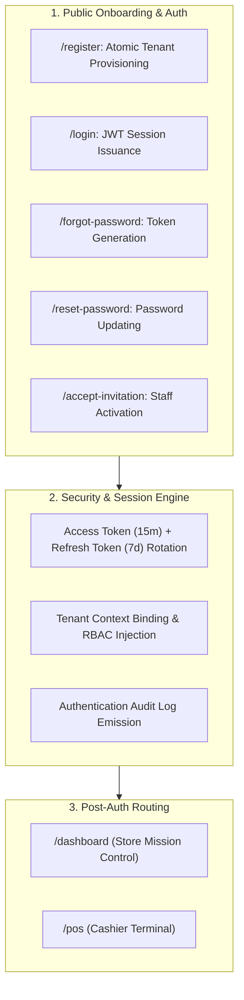

---

### Detailed Feature Breakdown

#### 1. Business Registration & Atomic Tenant Provisioning (`/register`)
- **Self-Serve Business Onboarding (`POST /api/v1/auth/register-business`)**:
  - **Account Owner Fields**: Full Name, Work Email, Contact Phone, and Secure Password.
  - **Business Entity Fields**: Business Name, URL-friendly Slug (`slugifyBusinessName`), Business Type (Retail, Restaurant, Pharmacy, Mart, Cafe, Service, Wholesale), Base Currency (`USD` or `KHR`), System Language (`English` or `Khmer`).
  - **First Store Branch Fields**: Main Branch Name (e.g. *"Phnom Penh Main"*), Branch Code (e.g. `PP-01`), Physical Address.
- **Database Transaction Guarantees**:
  - Executed inside a single ACID database transaction.
  - Atomically provisions:
    1. Tenant record with default currency, language, and slug uniqueness check.
    2. User account with bcrypt-hashed password.
    3. Main Store Branch flagged as `isMain: true`.
    4. Employee profile mapped to the owner user.
    5. Owner Role populated with full system administrative permissions.
    6. System exchange rate initialized (e.g. `1 USD = 4,100 KHR`).
    7. Default numbering sequence records (`ORD-`, `PUR-`, `RET-`, `TRF-`, `EXP-`, `INC-`, `SHF-`).
    8. Free-tier SaaS subscription record with 30-day initial trial.

#### 2. Authentication & Session Architecture (`/login`)
- **Dual-Token Security (`POST /api/v1/auth/login`)**:
  - Verifies user email and password credentials.
  - Emits short-lived Access Token (JWT, 15-minute validity) carrying `userId`, `tenantId`, `activeBranchId`, and authorized permission codes.
  - Emits long-lived Refresh Token (HttpOnly, Secure, SameSite cookie, 7-day validity).
- **Silent Token Rotation (`POST /api/v1/auth/refresh-token`)**:
  - Automatically requested by web client when access token approaches expiration.
  - Invalidates old refresh token and rotates a new cryptographic refresh token on every invocation.
- **Multi-Tenant Workspace Switching (`POST /api/v1/auth/switch-tenant`)**:
  - Allows users who own or work at multiple companies to instantly switch active tenant context without logging out.
- **Active Branch Selection (`POST /api/v1/auth/select-branch`)**:
  - Binds the active session to the selected branch terminal context.

#### 3. Password Recovery Flow (`/forgot-password` & `/reset-password`)
- **Forgot Password Request (`POST /api/v1/auth/forgot-password`)**:
  - Accepts user email, verifies presence without leaking user enumeration.
  - Generates single-use password reset token with 1-hour expiration timestamp.
  - Emits recovery email containing one-click `/reset-password?token=...` link.
- **Reset Password Form (`POST /api/v1/auth/reset-password`)**:
  - Validates token authenticity and expiration.
  - Updates password hash, invalidates token, and terminates all active sessions across other devices.

#### 4. Team Member Invitation Acceptance (`/accept-invitation`)
- **Staff Activation Flow (`POST /api/v1/auth/accept-invitation`)**:
  - Validates token issued by tenant administrator from `/access`.
  - Prompts employee to set their secure personal password.
  - Atomically binds their user account to the invited tenant and assigns the pre-selected role and branch access permissions.

---

### 1.15 SaaS Platform Administration (`/platform`)

The SaaS Platform Administration module is a dedicated super-administrator portal decoupled from individual tenant dashboards. It provides platform-level oversight, infrastructure telemetry, tenant governance, and system-wide subscription lifecycle enforcement.

> [!IMPORTANT]
> **Strict Cross-Tenant Isolation Guarantee:** Tenant administrators and cashiers cannot access another tenant's information or platform administrator pages. All `/platform/*` endpoints enforce the `requirePlatformAdmin` guard (`req.auth.isPlatformAdmin === true`), returning HTTP 403 Forbidden (`PLATFORM_ADMIN_ONLY`) to unauthorized users.

---

### Key Sections & Component Architecture

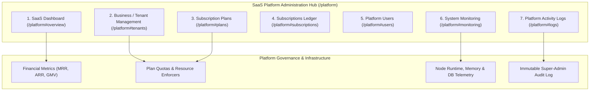

---

### Detailed Feature Breakdown

#### 1. SaaS Dashboard (`/platform` — Tab: `overview`)
- **API Endpoint:** `GET /api/v1/platform/overview`
- **Platform Executive Metrics**:
  - **Total Tenants**: Total businesses registered on the SaaS platform (Active vs Suspended counts).
  - **Financial Metrics**: Monthly Recurring Revenue (MRR) and Annual Run Rate (ARR) across all subscriber plans.
  - **Total Outlets**: Combined store branch network footprint across Cambodia.
  - **Platform User Base**: Total registered user accounts across all tenant organizations.
  - **Global Orders & GMV**: Cumulative retail order count and Gross Merchandise Value processed by the system.
  - **System Health Badge**: Real-time operational indicator (`OPERATIONAL`, 100% services online).

#### 2. Business / Tenant Management (`/platform` — Tab: `tenants`)
- **API Endpoints:** `GET /api/v1/platform/tenants`, `PATCH /api/v1/platform/tenants/:tenantId/status`
- **Tenants Registry Table**:
  - Columns: Business Name, Slug, Business Type (Retail, Restaurant, Mart, Cafe, Pharmacy), Operating Currency (`USD`/`KHR`), Branch Count, User Count, Lifetime Orders, Status Badge, and Joined Date.
  - Search by company name, slug, or email; filter by status (`ALL`, `ACTIVE`, `SUSPENDED`).
  - **Tenant Suspension Enforcer**:
    - 1-click **"Suspend Tenant"** / **"Activate Tenant"** action.
    - Suspended tenants receive an HTTP 403 Forbidden (`TENANT_SUSPENDED`), locking POS and back-office access until reinstated by a platform administrator.
  - 1-click CSV export of the complete merchant registry.

#### 3. Subscription Plans (`/platform` — Tab: `plans`)
- **API Endpoints:** `GET /api/v1/platform/plans`, `POST /api/v1/platform/plans`
- **Subscription Plans Catalog**:
  - Visual cards for default and custom plans: `FREE_TRIAL`, `STARTER`, `GROWTH`, `ENTERPRISE`.
  - Monthly & Annual Pricing in USD.
  - Resource Quotas: Maximum Branches, Maximum Staff/Employees, and Maximum Catalog Products.
  - Feature Entitlement tags (`pos`, `sales`, `inventory`, `transfers`, `analytics`, `pwa_offline`, `custom_receipts`).
  - **Create / Edit Plan Modal**:
    - Dialog for provisioning new tiers or adjusting pricing and resource ceilings.

#### 4. Subscriptions Ledger (`/platform` — Tab: `subscriptions`)
- **API Endpoints:** `GET /api/v1/platform/subscriptions`, `PATCH /api/v1/platform/subscriptions/:subscriptionId`
- **Active Subscriptions Tracking**:
  - Cross-tenant subscription ledger displaying Tenant Name & Slug, Current Plan Tier, Billing Cycle (`MONTHLY` vs `YEARLY`), Monthly Contribution Value, Status (`ACTIVE`, `TRIAL`, `PAST_DUE`, `CANCELLED`), and Current Period Renewal Date.
  - **Override Controls**:
    - Manually override subscription statuses (e.g. grant trial extensions, mark delinquent accounts as `PAST_DUE`, or cancel).

#### 5. Platform Users (`/platform` — Tab: `users`)
- **API Endpoints:** `GET /api/v1/platform/users`, `PATCH /api/v1/platform/users/:userId`
- **Global User Directory**:
  - Directory of all registered user identities across the platform.
  - Columns: User Name, Email, Phone, Platform Role (`Platform Admin` vs `Tenant User`), Workspace Count (number of merchant stores they belong to), Status (`ACTIVE` / `INACTIVE`), and Created Date.
  - Search by name/email, filter by role (`ALL`, `ADMIN`, `TENANT`).
  - **Admin Privilege Toggle**:
    - 1-click action to promote a user to Platform Administrator or revoke administrative privileges with immutable activity logging.

#### 6. System Monitoring & Health (`/platform` — Tab: `monitoring`)
- **API Endpoint:** `GET /api/v1/platform/monitoring`
- **Live Infrastructure Telemetry**:
  - **Runtime Process Health**: Process Uptime (`Xh Ym Zs`), Node.js version, Host OS, and CPU Logical Core counts.
  - **Memory Meters**: Resident Set Size (RSS), Process Heap Memory Used vs Total with dynamic progress bars.
  - **Database Status**: Engine status (`CONNECTED`), live table record counters across `tenants`, `users`, `branches`, `orders`, `products`, and `activityLogs`.
  - **Automated Backup & Disaster Recovery**: Rolling snapshot status (`HEALTHY`), 10-snapshot retention rotation, and SHA-256 cryptographic verification.

#### 7. Platform Activity Logs (`/platform` — Tab: `logs`)
- **API Endpoint:** `GET /api/v1/platform/activity-logs`
- **Super-Admin Audit Feed**:
  - Immutable audit trail capturing all administrative actions across the platform: `tenant.status_changed`, `plan.created`, `plan.updated`, `subscription.updated`, `user.platform_role_updated`.
  - Columns: Timestamp, Action verb, Module (`platform`), Record Type, Actor Email, and IP Address.
  - **Side-by-Side Diff Inspector**:
    - Modal displaying highlighted `Previous Values` (in rose) vs `New Values` (in emerald) for complete forensic traceability.

---

### Backend API Reference

- **Platform Super-Admin Routes**:
  - `GET /api/v1/platform/overview`: Platform-wide tenant, branch, financial, and order telemetry.
  - `GET /api/v1/platform/tenants`: List all tenants with branch and user aggregates.
  - `PATCH /api/v1/platform/tenants/:tenantId/status`: Toggle tenant active or suspended state.
  - `GET /api/v1/platform/plans`: Retrieve all subscription tiers and resource quotas.
  - `POST /api/v1/platform/plans`: Create or update subscription plan pricing and limits.
  - `GET /api/v1/platform/subscriptions`: List all active merchant subscriptions and renewal dates.
  - `PATCH /api/v1/platform/subscriptions/:subscriptionId`: Override tenant subscription plan or status.
  - `GET /api/v1/platform/users`: List all platform users and their tenant memberships.
  - `PATCH /api/v1/platform/users/:userId`: Promote or revoke platform administrator privileges.
  - `GET /api/v1/platform/monitoring`: Real-time Node.js process, memory, database, and backup diagnostics.
  - `GET /api/v1/platform/activity-logs`: Cross-tenant super-admin security audit trail.
- **Tenant Isolation Safeguards**:
  - Every platform route requires `authenticate` and `requirePlatformAdmin` middleware (`req.auth.isPlatformAdmin === true`).
  - Regular store owners, managers, and cashiers are blocked with HTTP 403 Forbidden (`PLATFORM_ADMIN_ONLY`).
  - In tenant-facing modules, all database queries enforce `{ where: { tenantId } }` so no merchant can view another tenant's orders, products, inventory, customers, or financials.


