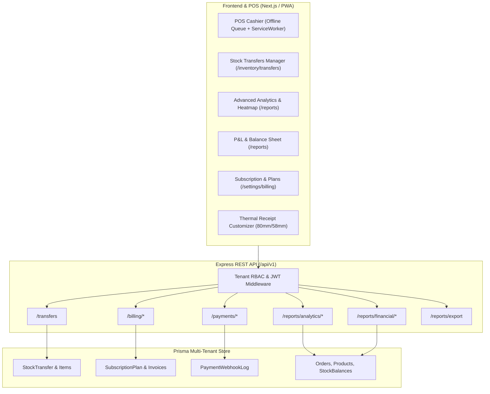

# Cambodia POS SaaS — Version 2: Business Expansion Specification & Guide

This document specifies the technical architecture, data models, REST APIs, frontend components, and offline capabilities implemented for **Version 2 — Business Expansion**.

---

## Table of Contents
1. [Overview & Scope](#1-overview--scope)
2. [Database Schema Additions](#2-database-schema-additions)
3. [Module 1: Advanced Analytics](#3-module-1-advanced-analytics)
4. [Module 2: Branch Stock Transfers](#4-module-2-branch-stock-transfers)
5. [Module 3: Advanced Financial Reports](#5-module-3-advanced-financial-reports)
6. [Module 4 & 5: Subscription Plans & Tenant Billing](#6-module-4--5-subscription-plans--tenant-billing)
7. [Module 6: Automated Payment Integrations (Bakong KHQR & PayWay)](#7-module-6-automated-payment-integrations-bakong-khqr--payway)
8. [Module 7: Receipt Customization](#8-module-7-receipt-customization)
9. [Module 8: Advanced Reporting Exports](#9-module-8-advanced-reporting-exports)
10. [Module 9: PWA & Offline POS Capabilities](#10-module-9-pwa--offline-pos-capabilities)
11. [Verification & Test Coverage](#11-verification--test-coverage)

---

## 1. Overview & Scope

Version 2 builds upon the Version 1 Core POS MVP, expanding single-store operations into enterprise-ready multi-branch retail management with automated payments, offline resiliency, and subscription SaaS commercialization.



---

## 2. Database Schema Additions

The Prisma schema (`apps/api/prisma/schema.prisma`) was expanded with:

### 2.1 Stock Transfer Models
- `StockTransfer`:
  - `id`: UUID Primary Key
  - `tenantId`: Multi-tenant isolation key
  - `transferNumber`: Formatted document identifier (e.g. `TR-2026-0001`)
  - `fromBranchId` / `toBranchId`: Source and destination branch references
  - `status`: `PENDING` | `IN_TRANSIT` | `COMPLETED` | `CANCELLED`
  - `createdById` / `sentById` / `receivedById`: Audit tracking references to `Employee`
  - `sentAt` / `receivedAt`: Lifecycle timestamps
  - `notes`: Audit explanations
- `StockTransferItem`:
  - `id`: UUID Primary Key
  - `stockTransferId`: Foreign key to `StockTransfer`
  - `productId`: Item transferred
  - `quantity`: `Decimal(18, 4)` transferred volume

### 2.2 Subscription & Billing Models
- `SubscriptionPlan`:
  - `id`: UUID Primary Key
  - `tier`: `FREE_TRIAL` | `STARTER` | `GROWTH` | `ENTERPRISE`
  - `name`: Display name
  - `monthlyPrice` / `yearlyPrice`: Pricing in USD
  - `maxBranches` / `maxEmployees` / `maxProducts`: Resource quotas
  - `features`: JSON string array of enabled feature flags
- `TenantSubscription`:
  - `tenantId`: Unique foreign key to `Tenant`
  - `planId`: Foreign key to `SubscriptionPlan`
  - `status`: `ACTIVE` | `PAST_DUE` | `CANCELLED` | `TRIAL`
  - `billingCycle`: `MONTHLY` | `YEARLY`
  - `currentPeriodStart` / `currentPeriodEnd`: Billing active window
  - `paymentMethod`: `BAKONG_KHQR` | `CREDIT_CARD` | `BANK_TRANSFER`
- `SubscriptionInvoice`:
  - `id`: UUID Primary Key
  - `invoiceNumber`: Auto-sequenced billing invoice number
  - `subscriptionId` / `tenantId`: Tenant linkage
  - `amount`: `Decimal(18, 2)`
  - `currency`: Default `USD`
  - `status`: `PAID` | `UNPAID` | `VOIDED`
  - `paidAt`: Timestamp
- `PaymentWebhookLog`:
  - `provider`: `BAKONG` | `PAYWAY`
  - `transactionHash`: Transaction identifier
  - `externalReference`: Linked order or invoice number
  - `payload`: Raw webhook payload
  - `status`: `SUCCESS` | `FAILED`

---

## 3. Module 1: Advanced Analytics

### Capabilities
- **Hourly Sales Heatmap**: 24-hour distribution of sales volume, order density, and average order value (AOV) to identify peak rush hours and optimize staff shift scheduling.
- **Product Affinity (Market Basket Analysis)**: Identifies products frequently purchased together in the same basket/order, calculating co-occurrence counts and percentage affinity.
- **Customer Retention & Churn**: Segments customer base into:
  - *New Customers* (1 purchase)
  - *Returning Customers* (2-4 purchases)
  - *Loyal Customers* (5+ purchases)
  - Calculates repeat purchase rate (%) and average lifetime value (LTV).

### API Endpoints
- `GET /api/v1/reports/analytics/hourly-heatmap?branchId=&dateFrom=&dateTo=`
- `GET /api/v1/reports/analytics/product-affinity?branchId=&dateFrom=&dateTo=`
- `GET /api/v1/reports/analytics/customer-retention?branchId=&dateFrom=&dateTo=`

---

## 4. Module 2: Branch Stock Transfers

### Stock Lifecycle & Reconciliation
1. **Creation (`PENDING`)**: Source and destination branches selected; items and quantities specified. Stock is not yet deducted.
2. **Dispatch (`IN_TRANSIT`)**: Stock is decremented at `fromBranchId` with ledger record `transfer_out`. Stock transfer enters transit state.
3. **Receipt (`COMPLETED`)**: Stock is incremented at `toBranchId` with ledger record `transfer_in`.
4. **Cancellation (`CANCELLED`)**:
   - If cancelled while `PENDING`: No stock reversal needed.
   - If cancelled while `IN_TRANSIT`: Stock is returned to `fromBranchId` with `transfer_in` adjustment.

### API Endpoints
- `POST /api/v1/transfers` — Create transfer request
- `GET /api/v1/transfers` — List transfers with status and branch filters
- `GET /api/v1/transfers/:id` — Retrieve transfer details and line items
- `POST /api/v1/transfers/:id/send` — Dispatch transfer (decrements source stock)
- `POST /api/v1/transfers/:id/receive` — Accept transfer (increments destination stock)
- `POST /api/v1/transfers/:id/cancel` — Abort transfer and restore stock if in transit

---

## 5. Module 3: Advanced Financial Reports

### Capabilities
- **Profit & Loss (P&L) Statement**:
  - Gross Revenue (Net of Discounts)
  - Cost of Goods Sold (COGS) based on FIFO snapshot unit cost
  - Gross Profit & Gross Margin %
  - Operating Expenses categorized by expense type
  - Additional Non-Operating Income
  - Net Profit & Net Margin %
- **Balance Sheet Statement**:
  - Current Assets: Cash on Hand (active shifts/balances), Inventory Asset Value (at cost), Accounts Receivable
  - Current Liabilities: Accounts Payable to suppliers, Unpaid Invoices
  - Net Working Capital
- **Tax & VAT Declaration Summary**:
  - Output VAT (Collected on sales)
  - Input VAT (Paid on purchases)
  - Net VAT Payable / (Refundable)
  - Exempt sales & total taxable base

### API Endpoints
- `GET /api/v1/reports/financial/pnl?branchId=&dateFrom=&dateTo=`
- `GET /api/v1/reports/financial/balance-sheet?branchId=`
- `GET /api/v1/reports/financial/tax-summary?branchId=&dateFrom=&dateTo=`

---

## 6. Module 4 & 5: Subscription Plans & Tenant Billing

### Plans Matrix
| Tier | Monthly Price | Yearly Price | Max Branches | Max Staff | Max Products | Included Features |
| :--- | :--- | :--- | :--- | :--- | :--- | :--- |
| **FREE_TRIAL** | \$0 | \$0 | 1 | 2 | 200 | POS, Sales, Inventory, Reports |
| **STARTER** | \$19 | \$190 | 1 | 5 | 1,000 | Core POS, Customers, Suppliers, Reports |
| **GROWTH** | \$49 | \$490 | 3 | 15 | 10,000 | Transfers, Analytics, Purchasing, Offline PWA |
| **ENTERPRISE** | \$99 | \$990 | Unlimited | Unlimited | Unlimited | All features, Custom Receipts, API Access |

### API Endpoints
- `GET /api/v1/billing/plans` — Public plan catalog
- `GET /api/v1/billing/subscription` — Current tenant subscription & quota usage
- `POST /api/v1/billing/subscription/change` — Upgrade or switch plan tier and billing cycle

---

## 7. Module 6: Automated Payment Integrations (Bakong KHQR & PayWay)

### Capabilities
- **Bakong KHQR Payload Generator**: Generates standard EMVCo-compliant KHQR payload string and deep link (`bakong://pay?qr=...`) for instant mobile banking app checkout.
- **Bakong Webhook Listener**: Verifies incoming transaction hash, updates corresponding order payment status, and logs event in `PaymentWebhookLog`.
- **ABA PayWay Webhook Listener**: Validates incoming transaction callback, marks order as paid, and persists audit log.

### API Endpoints
- `POST /api/v1/payments/generate-khqr` — Dynamic QR payload & deep link generation
- `POST /api/v1/payments/webhooks/bakong` — Bakong instant confirmation webhook
- `POST /api/v1/payments/webhooks/payway` — ABA PayWay callback webhook
- `GET /api/v1/payments/integrations` — Active payment gateway statuses & recent webhook audit logs

---

## 8. Module 7: Receipt Customization

### Capabilities
- **Paper Profiles**: Toggle between standard **80mm** (wide receipt) and **58mm** (compact thermal paper).
- **Branding & Layout Controls**:
  - Show/Hide Store Logo
  - Header Title, Subtitle, and Business Address
  - Tax / VAT Number display toggle
  - Cashier & Branch details toggle
  - Barcode / QR code display on receipt footer
  - Custom Footer Notice (e.g., Return policy, WiFi password, social media handles)
  - Font Size adjustments (Small / Normal / Large)
- **Live Thermal Preview**: Real-time rendering in `ReceiptCustomizer.tsx` simulating physical thermal printer paper.

---

## 9. Module 8: Advanced Reporting Exports

### Capabilities
- Supports on-demand CSV data streaming for any financial or operational report:
  - `pnl`: Detailed line-by-line Profit & Loss CSV
  - `sales`: Detailed sales transactions with payment breakdowns
  - `inventory`: Current branch stock balances, SKUs, and valuations
  - `tax`: Tax & VAT declaration audit export
- Sets compliant headers:
  - `Content-Type: text/csv; charset=utf-8`
  - `Content-Disposition: attachment; filename="report-<type>-<date>.csv"`

### API Endpoint
- `GET /api/v1/reports/export?type=pnl|sales|inventory|tax&branchId=&dateFrom=&dateTo=`

---

## 10. Module 9: PWA & Offline POS Capabilities

### Architecture
- **Web App Manifest (`public/manifest.json`)**: Configured with `display: "standalone"`, POS icons, and Cambodian bilingual descriptions for home screen installation on Android, iOS, and POS terminal touch displays.
- **Service Worker (`public/sw.js`)**:
  - Network-first caching strategy for static POS assets, icons, and shell.
  - Offline fallback page when no internet connection is detected.
- **Offline Sync Queue (`src/lib/offlineStore.ts`)**:
  - Browser `IndexedDB` with fallback to `localStorage`.
  - Queues sales orders created during internet outages.
  - Automatically listens to `window.online` events to drain and sync pending transactions when network recovers.
  - Local product catalog caching for continuous barcode scanning while offline.

---

## 11. Verification & Test Coverage

### Automated Test Suite
- `apps/api/tests/version2.api.test.ts` (5 integration test suites, 100% pass rate):
  1. `V2-Transfers`: Full stock transfer lifecycle with transit reservations and branch stock increases.
  2. `V2-Analytics`: Hourly sales density, market basket affinities, and customer retention metrics.
  3. `V2-Financials`: Structured P&L, balance sheet statement, VAT tax summary, and CSV export.
  4. `V2-Subscription`: Tiered plans, resource quotas, and plan upgrades.
  5. `V2-Payments`: Bakong KHQR dynamic payloads and automated webhook confirmations.

### Global Monorepo Test Summary
```
Test Files  6 passed (6)
Tests       38 passed (38)
- @cambodia-pos/shared: 6/6 passed
- @cambodia-pos/api:    30/30 passed
- @cambodia-pos/web:    2/2 passed
Typecheck:  Clean (exit code 0 across all workspaces)
```

